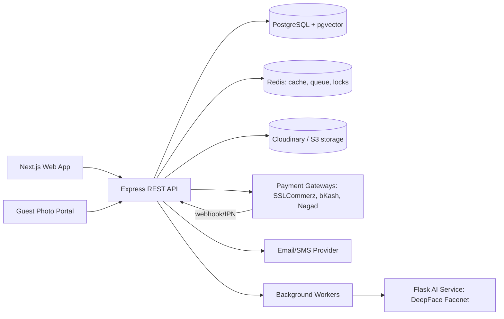
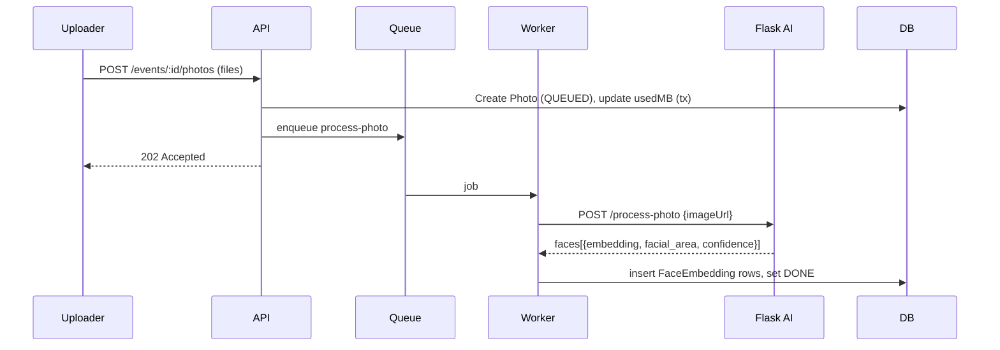
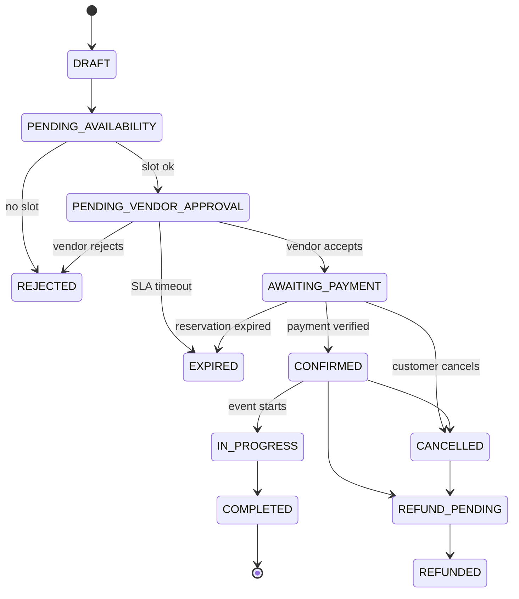
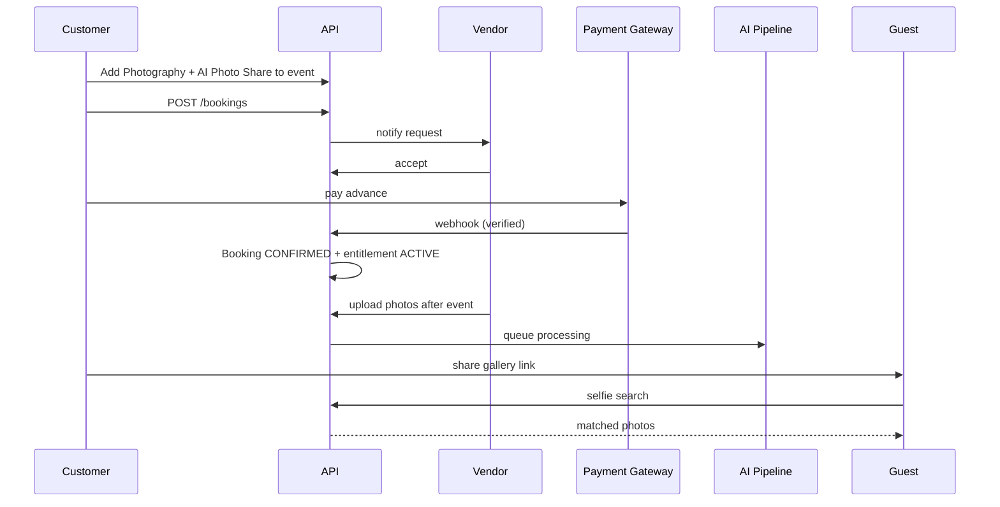

# SOFTWARE REQUIREMENTS SPECIFICATION (SRS)

## Eventora — Event Marketplace, Event Planning Management & AI Photo Share System

| Item | Value |
|---|---|
| Document Version | 2.1 (Dynamic Configuration Engine added — see §36) |
| Project Type | Multi-Vendor Event Marketplace + AI Photo Delivery |
| Initial Market | Bangladesh |
| Currency | BDT (৳) — stored as integer paisa or `Decimal(14,2)` |
| Platform | Responsive Web Application (+ REST API for future mobile) |
| Backend | Node.js, Express, TypeScript, Prisma, PostgreSQL, Zod |
| AI Microservice | Python Flask + DeepFace (Facenet) — already in `/ai-service` |
| Status | Ready for Technical Design and Implementation |

---

## Table of Contents

1. Introduction
2. Existing System Baseline (Brownfield Analysis)
3. System Overview
4. User Roles, Permissions & RBAC Matrix
5. Public Website Requirements
6. Authentication & Account Management
7. Customer Profile
8. Event Creation & Management
9. Event Planner Module
10. Vendor Management Module
11. Service & Package Management
12. **AI Photo Share Module (Photography Add-on Service)**
13. Booking Management
14. Availability & Calendar
15. Payments & Financial Management
16. Ready-made Event Packages
17. Offers, Coupons & Promotions
18. Customer Event Management Tools
19. Communication & Notifications
20. Reviews & Ratings
21. Search & Recommendation
22. Admin Dashboard
23. Business Rules
24. Database Design
25. REST API Specification
26. State Machines
27. Non-Functional Requirements
28. Technology Stack & Architecture
29. System Workflows
30. Development Phases & Migration Plan
31. Testing Requirements
32. Acceptance Criteria
33. Future Enhancements
34. Architectural Decisions
35. Glossary & Final Definition
36. **Dynamic Event-Type, Service, Food & Pricing Engine (authoritative)**

---

# 1. Introduction

## 1.1 Purpose
Eventora is a multi-vendor event marketplace and planning platform. Customers discover, compare, select, book and manage event services (venue, decoration, photography, catering, etc.) under one event. Vendors sell services and track earnings. Administrators govern the marketplace.

A distinguishing feature is the **AI Photo Share Service**: when a customer books a **Photography** service for an event, the vendor/photographer (or event owner) can attach the **AI Photo Share add-on**. Event photos are uploaded to the event gallery, faces are detected and embedded by the AI service, and guests can upload a selfie to instantly retrieve every photo they appear in.

## 1.2 Objectives
1. Centralized event service marketplace.
2. Simplified event planning with an integrated Event Planner.
3. Multiple vendors and multiple bookings per event.
4. Transparent pricing and package comparison.
5. Automated booking, availability and notification workflows.
6. Revenue via commissions, AI photo-share subscriptions/add-ons, featured listings and promotions.
7. Post-event value through AI face-search photo sharing.
8. Event management tools (guests, RSVP, checklist, timeline, budget).

## 1.3 Scope
Interfaces:
1. Public Website
2. Customer Dashboard
3. Vendor Dashboard
4. Admin Dashboard
5. Guest Photo Portal (public link + selfie search, no login)
6. Event Manager workspace (future release)

## 1.4 Target Users
Individual customers, families/organizers, corporate customers, event vendors, photographers, professional planners, event guests (photo portal), platform administrators.

## 1.5 Definitions
| Term | Meaning |
|---|---|
| Event | A customer's occasion, of an Admin-defined EventType |
| Event Planner | Event-linked multi-vendor selection workspace (not a cart) |
| Booking | Independent vendor-service reservation with its own status and payment |
| EventService | A planner selection (pre-booking) |
| AI Photo Share | Face-recognition photo delivery add-on attached to an Event |
| Embedding | Face feature vector (Facenet, 128-d) stored per detected face |
| Snapshot | Immutable copy of price/terms at booking time |

---

# 2. Existing System Baseline (Brownfield Analysis)

The repository already contains a working **photo-sharing backend**. This section maps it to Eventora so that nothing is rewritten unnecessarily.

## 2.1 Current Assets
| Area | Current implementation |
|---|---|
| Stack | Express 4, TypeScript, Prisma 5, PostgreSQL, Zod, JWT, bcrypt, Cloudinary, multer, archiver |
| Modules | `auth`, `user`, `package`, `event`, `photo`, `ai`, `review` |
| Models | `User(role USER/SUPER_ADMIN)`, `Package` (storage plan), `Event(title, coverImage, isActive, userId)`, `Photo(imageUrl, publicId, sizeMB, eventId)`, `FaceEmbedding(photoId, vector Json)`, `Review` (site testimonial) |
| AI service | Flask: `POST /process-photo` (detect + embed faces), `POST /search-face` (selfie vs candidate vectors, cosine threshold 0.55), model Facenet |
| Routes | `/auth`, `/packages`, `/users` (dashboard, select-package, admin), `/events`, `/photos` (upload, delete, list, ZIP download), `/ai` (search-face, process-photo, reprocess-event), `/reviews` |
| Storage plans | `User.packageId`, `usedStorageMB`, activation/expiry dates |

## 2.2 Mapping to Eventora
| Existing | Becomes in Eventora |
|---|---|
| `Package` (storage plan) | Renamed conceptually to **`StoragePlan`** / "AI Photo Share Plan". The name `Package` is reserved for marketplace service/event packages. Table remapped via migration (`@@map("storage_plans")`). |
| `Event` (title, cover) | Extended into full marketplace `Event` (category, date, guests, location, budget, status, `eventNo`) |
| `Photo`, `FaceEmbedding` | Retained; belong to `Event` → `EventGallery` feature |
| `AI` module | Retained as **AI Photo Share** module; gated by an active add-on entitlement |
| `User.role (USER, SUPER_ADMIN)` | Replaced by RBAC (`Role`, `Permission`, `UserRole`); `USER`→`CUSTOMER`, `SUPER_ADMIN`→`SUPER_ADMIN` |
| `Review` (site review) | Retained as site testimonial (CMS); marketplace `ServiceReview` added separately |
| `User.isActive` default false | Replaced by `status` enum (`PENDING_VERIFICATION, ACTIVE, SUSPENDED, DELETED`) |

## 2.3 Known Gaps to Fix (must be done in implementation)
1. Package routes (`POST/PATCH/DELETE /packages`) are unauthenticated → must require admin permission.
2. Role is a binary enum → move to granular RBAC.
3. Embedding vectors are `Json`; search sends all candidates to Flask → move to `pgvector` (or batch-limited search) for scale.
4. AI processing is synchronous on upload → move to background queue (BullMQ/Redis) with job status.
5. Storage quota accounting is not transactional → wrap in DB transaction with atomic increment.
6. Selfie search is authenticated-only → add public guest search via signed event share token, rate limited.
7. No consent / biometric privacy handling → see §12.9.
8. Add validation (Zod) to all routes, pagination, audit logs, and Helmet/rate limit.

---

# 3. System Overview

## 3.1 Business Concept
Independent vendors provide services. The customer creates an Event, selects multiple services from different vendors, and each selection becomes its own booking.

Example (Wedding):

| Service | Vendor | Price |
|---|---|---:|
| Venue | Royal Convention Hall | ৳80,000 |
| Photography (+AI Photo Share) | Dream Photography | ৳25,000 + ৳3,000 |
| Catering | Food Paradise | ৳90,000 |
| Decoration | Floral Decoration BD | ৳35,000 |
| **Total** | | **৳2,33,000** |

## 3.2 Event Types (formerly Event Categories) — sample seed data only
> Admin-managed dynamically; see §36. Nothing below is hardcoded.

Wedding, Engagement, Birthday Party, Anniversary, Get-together, Family Reunion, Corporate Event, Conference, Seminar, Workshop, Graduation Party, Baby Shower, Farewell Party, Cultural Event, Private Party. Admin can create/update/deactivate/reorder dynamically.

## 3.3 Service Categories — sample seed data only
> Grouping labels for services; services are assigned to event types per §36.

Venue Booking, Event Decoration, Photography, Videography, Catering, Makeup & Beauty, Stage Design, Sound & Lighting, Transportation, Entertainment, Event Planning, Invitation Design, Furniture & Equipment Rental. Admin-manageable. Each category has a flag `supportsAiPhotoShare` (true for Photography and Videography).

## 3.4 High-Level Architecture


---

# 4. User Roles, Permissions & RBAC Matrix

## 4.1 Roles
| Role | Description |
|---|---|
| GUEST | Unauthenticated visitor |
| CUSTOMER | Registered event owner |
| VENDOR | Business owner (after approval can publish) |
| VENDOR_STAFF | Optional vendor employee, limited |
| EVENT_MANAGER | Assigned-events operator (future) |
| ADMIN | Operational admin with scoped permissions |
| SUPER_ADMIN | Full control, manages admins and roles |
| PHOTO_GUEST | Anonymous gallery visitor via share token (not a stored account) |

## 4.2 Guest
Browse site, categories, services, vendor profiles, packages, prices, search/filter, read reviews, view offers, register/login. Must authenticate before creating events or bookings.

## 4.3 Customer
Profile, multiple events, edit events, planner, compare vendors/packages, favorites, budget, booking requests, payments, track/cancel bookings, refunds, guests, checklists, timeline, notifications, vendor chat, reviews after completion, **AI Photo Share: manage gallery, upload photos (if permitted), share guest link, download ZIP**.

## 4.4 Vendor
Register business, submit verification documents, manage profile, portfolio, services, packages, locations, availability, receive/accept/reject bookings, manage confirmed bookings, chat, view payments/commission, request payouts, respond to reviews, **upload event photos to the event gallery for bookings that include AI Photo Share**.

## 4.5 Event Manager (future)
Access only explicitly assigned events: view services, manage tasks and timeline, coordinate vendors, track bookings, message customers, report execution status.

## 4.6 Administrator
Manage users, vendors (approve/reject/suspend), event & service categories, services, packages, bookings, payments, commissions, refunds, promotions, coupons, review moderation, support tickets, analytics, CMS, system settings, roles and permissions, storage plans, AI photo share settings.

## 4.7 Permission Matrix (R = read, W = write, A = approve, O = own only)
| Resource | Guest | Customer | Vendor | Event Mgr | Admin | Super Admin |
|---|---|---|---|---|---|---|
| Public listings | R | R | R | R | R | R |
| Own profile | – | RW (O) | RW (O) | RW (O) | RW | RW |
| Events | – | RW (O) | R (booked, O) | RW (assigned) | R | RW |
| Event services/planner | – | RW (O) | R (own services) | RW (assigned) | R | RW |
| Services | R | R | RW (O) | R | RWA | RWA |
| Packages | R | R | RW (O) | R | RWA | RWA |
| Bookings | – | RW (O) | RA (O) | R (assigned) | RW | RW |
| Payments | – | R (O) | R (O, net) | – | RW | RW |
| Refunds | – | Request (O) | R (O) | – | A | A |
| Vendor approval | – | – | – | – | A | A |
| Commission config | – | – | R (O) | – | W (perm) | W |
| Coupons/promotions | R (public) | Apply | Vendor-offers (O) | – | RW | RW |
| Reviews | R | W (eligible) | Respond (O) | – | Moderate | Moderate |
| AI Gallery | Guest-link R | RW (O) | W upload (booked) | RW (assigned) | RW | RW |
| Storage plans | R | Purchase | Purchase | – | RW | RW |
| CMS | R | R | R | – | RW | RW |
| Roles/permissions | – | – | – | – | – | RW |
| Audit logs | – | – | – | – | R | R |

## 4.8 Granular Admin Permissions (examples)
`users.read`, `users.update`, `users.suspend`, `vendors.approve`, `vendors.reject`, `vendors.suspend`, `services.moderate`, `categories.manage`, `bookings.read`, `bookings.manage`, `payments.read`, `payments.manage`, `refunds.approve`, `commissions.configure`, `payouts.approve`, `coupons.manage`, `promotions.manage`, `reviews.moderate`, `cms.manage`, `settings.manage`, `roles.manage`, `audit.read`, `ai.manage`, `storage_plans.manage`.

---

# 5. Public Website Requirements

## 5.1 Homepage
Main navigation, hero, event category section, popular services, featured vendors, recommended packages, How It Works, special offers, testimonials, latest articles, newsletter, footer, an **AI Photo Share** highlight section ("Find your photos with one selfie"). Primary CTA **Plan Your Event**; secondary **Explore Services**.

## 5.2 Event Category Listing
View/search categories; description; relevant packages; start planning. Fields: name, slug, description, image, status, display order.

## 5.3 Service Marketplace
Search by name; filters: category, location, price range, rating, vendor, availability, verified vendor, AI-photo-share-supported; sorts: price, popularity, rating, newest. Cards show image, title, vendor, starting price, rating, location, short description, availability indicator, details action, "AI Photo Share available" badge. Pagination (default 12, max 50).

## 5.4 Service Details
Title, gallery, description, category, vendor info, location, packages, package comparison, availability calendar, reviews, terms, cancellation policy, related services, **Add to Event**, **Contact Vendor**, add-on selector (including AI Photo Share).

## 5.5 Vendor Public Profile
Business name, logo, description, verification badge, portfolio, services, packages, location, rating, reviews, contact options, policies. Only APPROVED and ACTIVE vendors are listed.

## 5.6 Package Listing
Ready-made multi-service packages with details, pricing, included services, terms, customization rules.

## 5.7 Guest Photo Portal (public)
URL: `/gallery/:shareToken`. Shows event title/cover, "Find my photos" selfie upload, matched photos, download single/all matches. No login. Rate-limited; consent notice shown.

## 5.8 Static/CMS Pages
About, Contact, FAQ, Terms, Privacy, Refund Policy, Blog, Biometric Data Notice.

---

# 6. Authentication & Account Management

## 6.1 Registration
- Email + password (mandatory in MVP).
- Phone + OTP (feature flag).
- Social login (future).
- Roles at registration: Customer by default. Vendor registration is a separate flow (§10).
- Fields: name, email, phone (BD format `01XXXXXXXXX`/`+8801…`), password (min 8, upper/lower/number).
- Email verification token (24h) → account becomes ACTIVE.

## 6.2 Login
- Email or phone + password; returns access token (15 min) + refresh token (7 d, httpOnly cookie, rotating, stored hashed in `Session`).
- Lockout: 5 failed attempts → 15 minute lock; audit-logged.
- Suspended users cannot log in.

## 6.3 Password Management
Forgot password (token, 30 min, single use), reset, change (requires current), revoke all sessions on change.

## 6.4 Security
bcrypt (≥10 rounds), JWT, refresh rotation with reuse detection, rate limits on auth endpoints, optional 2FA for admins (future), device/session list and revoke.

---

# 7. Customer Profile
Full name, email, phone, profile image, address, city, country, account status. Multiple saved addresses (`CustomerAddress`). Wishlist of services/vendors/packages. Account deletion = soft delete with anonymization of personal data while retaining financial records.

---

# 8. Event Creation & Management

## 8.1 Event Fields
| Field | Type | Required | Validation |
|---|---|---|---|
| Event Name | Text (3–120) | Yes | trimmed |
| Event Type (formerly Category) | Relation | Yes | must be active; drives which fields, services and food are available (§36) |
| Event Date | Date | Yes | ≥ today (draft may be flexible) |
| Start Time | Time | Opt | |
| End Time | Time | Opt | > start |
| Guest Count | Int | Yes | 1–100000 |
| Location | Address (+city, lat/lng optional) | Yes | |
| Timezone | IANA | Yes | default `Asia/Dhaka` |
| Estimated Budget | Decimal | Opt | ≥ 0 |
| Description | Text | Opt | |
| Special Requirements | Text | Opt | |
| Cover Image | URL | Opt | (reused from existing system) |

## 8.2 Event ID
Human-readable `eventNo` e.g. `EVT-2026-000001` (unique, generated via per-year sequence). Internal PK is UUID.

## 8.3 Event Status
`DRAFT, PLANNING, BOOKING_IN_PROGRESS, PARTIALLY_CONFIRMED, CONFIRMED, IN_PROGRESS, COMPLETED, CANCELLED, ARCHIVED`. Status is partly derived from booking states (see §26).

## 8.4 Event Management
Update info, guest count, location, budget; view selected services, booking progress, expenses, timeline; archive completed events. **Change of date/location triggers revalidation** of every active booking: availability rechecked; conflicting bookings move to `PENDING_AVAILABILITY` and vendors/customer are notified.

## 8.5 Event Cancellation vs Booking Cancellation
Separate flows (BR-19). Cancelling an event offers to cancel all bookings individually, each following its own cancellation policy and refund calculation.

## 8.6 Event Gallery (AI Photo Share link)
Each event may have an `EventGallery` with settings: enabled, share token, visibility, expiry, consent text, download permissions. Gallery activation requires an active AI Photo Share entitlement (§12).

---

# 9. Event Planner Module

## 9.1 Purpose
Event-linked workspace for selecting multiple services from multiple vendors. It is **not** a payment cart.

## 9.2 Add Service
Stored: event ID, service ID, vendor ID, package ID (opt), selected add-ons, selected price, quantity, notes, selection status, price snapshot (display only until booking). Adding does not create a booking (BR-07). Duplicate selection of the same service+package for the same date is blocked unless quantity > 1 is supported by the service.

## 9.3 Remove Service
Allowed only for `SELECTED` or `REJECTED/CANCELLED` items. Items with an active booking must use the cancellation workflow.

## 9.4 Replace Service
Replace an unbooked selection with another vendor/package; budget recalculated atomically.

## 9.5 Budget Calculation
- Selected service subtotal
- Add-on totals
- Confirmed booking cost
- Pending booking cost
- Discounts (validated coupons/promotions)
- Taxes (configurable VAT %)
- Platform/convenience fees (configurable)
- Total estimated cost
- Remaining budget = estimated budget − total estimated cost

`Total Event Cost = Σ(selected service prices + add-ons) × quantity + fees + taxes − discounts`

Pricing by type: fixed, starting, per person (× guest count), per hour (× hours), per day (× days), custom quotation (price entered by vendor after request; excluded from total until quoted).

## 9.6 Item Status
`SELECTED, BOOKING_PENDING, CONFIRMED, REJECTED, CANCELLED, COMPLETED`.

## 9.7 Service Comparison
Compare up to 4 services/packages on price, rating, reviews, features, location, availability for the event date, vendor verification, AI photo share support.

---

# 10. Vendor Management Module

## 10.1 Registration Fields
Business name, owner name, email, phone, business address, city, business category, description, logo, supporting documents (trade license, NID/passport, TIN optional). Creates a User with VENDOR role and a Vendor record in `PENDING`.

## 10.2 Vendor Application Status
`PENDING → UNDER_REVIEW → APPROVED | REJECTED`, plus `SUSPENDED`. Rejection requires a reason; vendors may re-apply. Admin actions are audit-logged and notify the vendor.

## 10.3 Vendor Profile
Slug (unique), logo, cover, description, policies, social links, service areas (`VendorServiceArea`), operating hours, rating aggregates.

## 10.4 Documents
Types: TRADE_LICENSE, NID, TIN, BANK_PROOF, OTHER. Status: PENDING/VERIFIED/REJECTED. Stored in private storage; accessed through signed URLs for admin only.

## 10.5 Portfolio
Images, videos, past projects with descriptions; admin moderation (`APPROVED/HIDDEN`).

## 10.6 Payout Account
Bank (name, account, branch, routing), bKash/Nagad number. Changes require re-verification and are audit-logged.

## 10.7 Vendor Dashboard
Today's bookings, pending requests, upcoming events, earnings (gross, commission, net), pending payouts, rating, reviews to respond, availability shortcuts, AI gallery uploads.

---

# 11. Service & Package Management

## 11.1 Service Fields
Title, slug, category, short and full description, images (≥1), location(s), base price, pricing type (`FIXED, STARTING, PER_PERSON, PER_HOUR, PER_DAY, CUSTOM_QUOTATION`), duration, guest capacity (min/max), terms, cancellation policy (policy tiers), status, `moderationStatus`, tags, FAQs, `supportsAiPhotoShare`, `isFeatured`.

Service status: `DRAFT, PENDING_REVIEW, ACTIVE, INACTIVE, REJECTED, ARCHIVED`. A service belongs to an APPROVED vendor only (BR-03).

## 11.2 Cancellation Policy Tiers
Example: ≥30 days before event: 90% refund; 15–29 days: 50%; 7–14 days: 25%; <7 days: 0%. Tiers are configurable per service, with platform default; snapshotted into the booking.

## 11.3 Packages (service-level)
Name, description, price, included features, add-ons (`ServiceAddon`), images, validity period, terms, customization availability, min/max guests, display order, status.

## 11.4 Add-ons
Name, description, price, pricing type, `type` (`GENERIC` or `AI_PHOTO_SHARE`), required flag. The AI Photo Share add-on links to a storage plan/limits (§12).

## 11.5 Rules
- Soft delete only when bookings exist.
- Price edits never affect existing bookings (snapshots).
- Image upload validated: JPEG/PNG/WebP, ≤10 MB each, ≤15 images.

---

# 12. AI Photo Share Module (Photography Add-on Service)

This module integrates the existing image-fetch / face-recognition system as a sellable add-on for Photography (and Videography stills) services.

## 12.1 Concept
When a customer adds a Photography service to an event they may enable the **AI Photo Share** add-on. After the shoot, photos are uploaded to the event's gallery. The AI processes every photo, detects faces and stores embeddings. Guests open the shared link, upload a selfie, and receive only the photos they appear in.

## 12.2 Entitlement Model
An event gets AI Photo Share access in one of three ways:
1. **Booked add-on:** `BookingAddon(type=AI_PHOTO_SHARE)` on a confirmed Photography booking; entitlement derived from the add-on's linked StoragePlan.
2. **Direct plan purchase:** customer buys a StoragePlan (existing `select-package` flow) from the dashboard without a photography booking (self-managed photographer / personal use).
3. **Admin grant:** admin assigns/extends a plan manually (existing `update-package` endpoint).

`AiPhotoShareEntitlement`: owner, event, plan, storage limit MB, used MB, activatedAt, expiresAt, status (`ACTIVE, EXPIRED, SUSPENDED`), source (`ADDON, PURCHASE, ADMIN`).

## 12.3 Storage Plans (existing `Package` renamed)
Name, storageLimitMB, description[], price, durationDays, status (`ACTIVE/INACTIVE`), `maxEvents`, `maxPhotosPerEvent`, `allowGuestPortal`, `allowZipDownload`, `retentionDays`. Admin CRUD requires `storage_plans.manage`.

## 12.4 Photo Upload
- Who: event owner, vendor whose Photography booking for the event is CONFIRMED/IN_PROGRESS/COMPLETED, assigned event manager, admin.
- Formats: JPEG, PNG, WebP (HEIC converted); ≤ 20 MB each; bulk up to 50 files per request; chunked/resumable upload recommended.
- Quota check and `usedMB` increment occur in a DB transaction; reject with `409 STORAGE_LIMIT_EXCEEDED` when exceeded.
- Stored to Cloudinary/S3 with `publicId`; thumbnail and web-size derivatives generated.
- Each photo gets `processingStatus`: `QUEUED → PROCESSING → DONE | FAILED | NO_FACE`.
- Uploads enqueue an AI job (BullMQ). The API returns immediately with the photo records.

## 12.5 AI Processing Pipeline

- Retries: 3 with exponential backoff; then `FAILED` with error; admin/owner can `reprocess`.
- Existing endpoints `POST /ai/process-photo` and `POST /ai/reprocess-event` remain (owner/admin only).
- Faces with detection confidence < 0.80 or area < 40×40 px are ignored.

## 12.6 Face Search
- Input: one selfie (JPEG/PNG ≤ 5 MB), event ID or share token.
- Flow: selfie → AI embedding (must contain exactly one prominent face) → compare against the event's embeddings → return matching photos ordered by similarity.
- Similarity: cosine, default threshold 0.55 (configurable in `SystemSetting`, per event override 0.40–0.80).
- **Scalability:** store embeddings as `vector(128)` using **pgvector** with an IVFFlat/HNSW index and perform the comparison in SQL (`<=>`) scoped by `eventId`; fall back to current Flask batch compare if pgvector is unavailable.
- Selfies are **not stored** persistently; they are deleted immediately after embedding (see §12.9).
- Response: `matches[{photoId, thumbUrl, imageUrl, similarity}]`, count, pagination.
- Error codes: `NO_FACE_DETECTED`, `MULTIPLE_FACES`, `GALLERY_DISABLED`, `GALLERY_EXPIRED`, `RATE_LIMITED`.

## 12.7 Guest Portal & Sharing
- Owner generates a share link with a high-entropy token (≥ 32 bytes), optional password, expiry date, download toggle.
- Token can be regenerated (old one invalidated) or disabled.
- Guests: view event header, search by selfie, view/download matched photos, download matches as ZIP (existing `archiver` ZIP feature, restricted to matched set for guests; entire event ZIP for owner).
- Public endpoints: rate limit 10 searches/IP/hour and 30/IP/day, CAPTCHA optional after 3 failures.
- Optional "Show all photos" mode (owner toggle) bypassing face search.
- Download tracking for analytics (count only).

## 12.8 Photo Management (Owner / Vendor)
List with pagination, filter by processing status, delete (decrements `usedMB`, deletes from storage, cascades embeddings), set cover image, bulk delete, favorite/hide photo, reorder, albums/tags (phase 2), watermark option (phase 2).

## 12.9 Privacy, Consent & Compliance (mandatory)
1. Face embeddings are biometric data → show consent notice on the guest portal before search ("Your selfie is used only to find your photos and deleted immediately").
2. Selfie bytes never persisted; only transient processing in memory/temp storage; log no embeddings.
3. Owner can disable face search and delete all embeddings of an event on demand.
4. Retention: when the entitlement expires, the gallery goes read-only for a 30-day grace period, then photos and embeddings are purged (configurable, with email warnings at 14/7/1 days).
5. A guest may request removal of a photo featuring them → "Report photo" action notifying owner/admin.
6. Embeddings are accessible only to the backend, never returned in APIs.
7. Access to galleries is authorized by ownership or valid share token.

## 12.10 Functional Requirements
| ID | Requirement |
|---|---|
| AI-01 | Customers can enable AI Photo Share on a Photography service when the vendor supports it. |
| AI-02 | The system shall create an entitlement on booking confirmation of an add-on. |
| AI-03 | Photo uploads shall be quota-checked transactionally. |
| AI-04 | Face embeddings shall be generated asynchronously per photo. |
| AI-05 | Guests shall find their photos via selfie without registering. |
| AI-06 | Selfies shall not be stored. |
| AI-07 | Owners shall download all event photos as ZIP. |
| AI-08 | Admin shall configure threshold, plans, retention, and rate limits. |
| AI-09 | Expired entitlements shall block uploads and (after grace) guest access. |
| AI-10 | Reprocessing of failed photos shall be available. |
| AI-11 | Vendor revenue from AI add-on is included in commission calculation. |

## 12.11 Revenue Handling
AI Photo Share add-on price is part of the booking amount → platform commission applies per commission policy (default 10%; admin can set a different rate for add-ons). A direct plan purchase is 100% platform revenue.

---

# 13. Booking Management

## 13.1 Architecture
One Event → many Bookings. Each booking has: one customer, one event, one vendor, one service, optional package, optional add-ons, independent status and payment records. Multi-service submission creates one booking per vendor service.

## 13.2 Booking Process
1. Customer selects a service and package/add-ons.
2. Chooses event date/time (inherited from event; can override per service).
3. System checks availability.
4. Customer submits request (`PENDING_VENDOR_APPROVAL`).
5. Vendor notified (in-app + email).
6. Vendor accepts/rejects within SLA (default 48 h; else `EXPIRED`).
7. Customer notified.
8. On accept → `AWAITING_PAYMENT`; a temporary reservation (default 30 min, configurable) is created.
9. Customer pays advance/full.
10. Verified payment + valid reservation → `CONFIRMED` (transaction).
11. Booking appears in both dashboards; AI add-on entitlement created if present.

Vendors with "instant booking" enabled skip step 6 (auto-accept).

## 13.3 Booking Status
`DRAFT, PENDING_AVAILABILITY, PENDING_VENDOR_APPROVAL, AWAITING_PAYMENT, CONFIRMED, IN_PROGRESS, COMPLETED, REJECTED, CANCELLED, EXPIRED, REFUND_PENDING, REFUNDED`. Every transition is recorded in `BookingStatusHistory` (from, to, actor, reason, timestamp).

## 13.4 Booking Reference
`BKG-2026-000001`, unique, sequence-based (separate counter table or DB sequence with year prefix).

## 13.5 Confirmation Conditions
1. Vendor approval satisfied (or instant booking).
2. Reservation active and slot reserved.
3. Required payment verified through gateway.
4. No conflicting confirmed booking.
All inside a serializable/`SELECT … FOR UPDATE` transaction with idempotency keys.

## 13.6 Price & Terms Snapshot
`BookingItem` stores: service title, package name, unit price, quantity, add-ons, pricing type, guest count at booking, cancellation policy JSON, terms text, commission rate, currency, tax, fees, discount breakdown. Never mutated after confirmation (BR-14/15).

## 13.7 Cancellation
- Initiated by customer, vendor (with penalties), or admin.
- Refund = paid amount × policy percentage (minus non-refundable gateway fee if configured).
- Vendor-initiated cancellations after confirmation → 100% refund to customer + vendor penalty/strike, flagged to admin.
- Reason required; `BookingCancellation` record stores refund calculation.
- Availability released; event status recalculated; notifications dispatched.

## 13.8 Completion
Auto-set `IN_PROGRESS` at event start and `COMPLETED` the day after the event if no dispute; vendor/customer can mark manually. Completion unlocks reviews and vendor payout eligibility (after settlement hold period, default 3 days).

## 13.9 Disputes
Customer may open a dispute within 7 days of completion → payout on hold → admin investigation → outcome: release, partial refund, full refund.

## 13.10 History
Customers and vendors can view and filter historical bookings, export CSV.

---

# 14. Availability & Calendar

## 14.1 Vendor Configuration
Available dates, blocked dates, weekly recurring schedule, time slots, max daily bookings, capacity per slot, buffer time before/after, lead time, advance booking window, per-service or per-vendor scope, bulk block.

## 14.2 Customer View
Month calendar per service showing Available / Limited / Unavailable / Reserved; time slot picker.

## 14.3 Double Booking Prevention
- Availability validated on create and on confirm.
- Exclusive services (venue, photographer): one confirmed booking per overlapping time window → enforced by Postgres **exclusion constraint** (`tstzrange` with `&&` via `btree_gist`) on `BookingReservation` plus row locks.
- Capacity services: counted reservations ≤ capacity via locked counter.
- Concurrent requests are serialized; the loser receives `409 SLOT_UNAVAILABLE`.

## 14.4 Temporary Reservation
`BookingReservation(status HELD|CONFIRMED|RELEASED|EXPIRED, expiresAt)`. Background job (every minute) expires HELD reservations and moves bookings to `EXPIRED`, releasing slots and notifying customer.

## 14.5 Timezones
Event stores local date/time + IANA timezone; reservation ranges stored in UTC.

---

# 15. Payments & Financial Management

## 15.1 Payment Methods
SSLCommerz (cards, mobile banking aggregator), bKash, Nagad, cards, bank transfer (manual proof upload, admin verify), cash/offline (admin-approved, vendor-specific). Gateway adapters implement a common `PaymentGateway` interface (`initiate`, `verify`, `refund`, `parseWebhook`).

## 15.2 Payment Options
Full, Advance (percentage: platform default 30%, overridable per vendor/service within limits), Remaining Balance (due date before event, reminders at 7/3/1 days). Unpaid remaining balance by due date → vendor/admin alerted; booking may be cancelled per policy.

## 15.3 Payment Record
Payment reference (`PAY-2026-000001`), booking ID, customer ID, amount, currency, method, gateway, gateway txn ID, status, paid timestamp, idempotency key, raw gateway payload (JSON, restricted access), purpose (`ADVANCE, FULL, BALANCE, AI_PLAN`).

## 15.4 Payment Status
`PENDING, PROCESSING, SUCCESSFUL, FAILED, CANCELLED, PARTIALLY_REFUNDED, REFUNDED`.

## 15.5 Gateway Flow
1. `POST /payments/initiate` validates booking/amount server-side, creates `Payment(PENDING)`, returns gateway URL.
2. Customer pays at gateway.
3. Gateway redirects (browser) and sends IPN/webhook (server).
4. Backend verifies via **server-to-server validation API** + signature/amount/currency/txn match (BR-18). Redirect alone is never trusted.
5. Idempotent processing: unique constraint on `(gateway, gatewayTxnId)`; repeated callbacks return 200 without side-effects.
6. On success, transaction: Payment → SUCCESSFUL, immutable `PaymentTransaction` appended, booking confirmation check, commission ledger row, notifications, invoice.
7. Failure/cancel → Payment FAILED/CANCELLED; reservation remains until expiry unless user retries.

## 15.6 Commission
Resolution order: vendor-specific rate → service-category rate → platform default (10%). Fields: rate type (percent/flat), effective-from, effective-to. The rate used is snapshotted on the booking. Example: ৳20,000 × 10% → platform ৳2,000, vendor ৳18,000. Rounding: half-up to 2 decimals; the vendor share = amount − commission to avoid rounding loss.

## 15.7 Ledger & Payouts
Append-only `LedgerEntry` (double-entry style): customer payment, commission, refund, payout, adjustment. Vendor wallet balances: `pending` (before completion + hold), `available`, `paidOut`.

Payout flow: vendor requests (min ৳1,000, only ≤ available) → admin approves → transfer (bank/bKash/Nagad, manual or API) → mark PAID with reference → ledger entry. Statuses: `REQUESTED, APPROVED, PROCESSING, PAID, REJECTED, FAILED`.

## 15.8 Refunds
Statuses: `REQUESTED, UNDER_REVIEW, APPROVED, REJECTED, PROCESSING, COMPLETED, FAILED`. Types: full, partial, rejected. Auto-calculated by cancellation policy; admin can override with reason. Refund executed via gateway API where supported or manual. Commission is reversed proportionally; vendor balance is debited (may go negative → recovered from future earnings).

## 15.9 Invoices & Receipts
Invoice number `INV-2026-000001`, PDF generated per payment/booking, emailed. Includes tax and fee lines. Immutable once issued; corrections use credit notes.

## 15.10 Audit
All financial tables are append-only; corrections are made by compensating entries. Admin financial actions → `AuditLog`.

---

# 16. Ready-made Event Packages

## 16.1 Creation
Admins and authorized vendors (or vendor alliances) create packages: name, slug, event categories, description, hero image, included items (service category/specific service/quantity, optional flag), package price, discount vs. à-la-carte, validity, min/max guests, terms, customization rules, status.

## 16.2 Types
- **Fixed bundle** (specific services).
- **Template bundle** (category slots filled by customer choice, e.g. "pick any photographer under ৳30k").

## 16.3 Selection
Selecting a package adds its items to the planner as grouped `EventService` rows (`packageGroupId`). System validates included services, vendor availability for event date, package validity, pricing, customization rules.

## 16.4 Customization
Remove optional items, add services, change guest count, select upgrades; price recalculated server-side before booking. Each underlying vendor still receives an independent booking.

---

# 17. Offers, Coupons & Promotions

## 17.1 Types
First booking discount, seasonal, early bird, combo package discount, coupon code, referral reward, flash sale, vendor-specific offers, featured service promotion.

## 17.2 Coupon Configuration
Code (unique, case-insensitive), discount type (`PERCENT/FLAT`), amount, minimum booking amount, max discount cap, total usage limit, per-user limit, start/expiry, applicable categories, vendors, services, event categories, first-booking-only flag, stackable flag, active status.

## 17.3 Validation (server-side)
Active, within date, usage limits (atomic increment inside transaction), min amount, applicability, per-user limit, non-stacking rules. Returns computed discount; stored in `CouponUsage` at payment success. Client-supplied discount amounts are never trusted.

## 17.4 Funding
Discount funded by `PLATFORM` or `VENDOR`; commission is computed on the amount after discount for vendor-funded, before discount for platform-funded (configurable).

## 17.5 Featured Listings
Vendors purchase featured placement (period, position). Admin approves; ordering in listings; analytics on impressions/clicks.

## 17.6 Referral
Unique referral code per user; reward credited as wallet/coupon after referee's first completed booking.

---

# 18. Customer Event Management Tools

## 18.1 Checklist
Task: title, description, due date, priority (LOW/MEDIUM/HIGH), assignee (collaborator/event manager), status (TODO/DONE), reminders. Default templates per event category.

## 18.2 Guest Management
Fields: name, phone, email, group, invitation status (`NOT_SENT, SENT, VIEWED`), RSVP (`PENDING, ACCEPTED, DECLINED, MAYBE`), plus-ones, special requirements, table assignment (future). Bulk import via CSV; export.

## 18.3 Digital Invitation
Templates (admin-managed), event/venue/date/time info, personal message, shareable link `/invite/:token`, RSVP form per guest (unique token), RSVP counts on dashboard. Invitation can link to the event's AI Photo Share gallery after the event ("Your photos are ready").

## 18.4 Event Timeline
Entries with time, title, description, owner/vendor; drag-reorder; shareable with vendors (read-only).

## 18.5 Budget Tracker
Estimated budget, confirmed expenses (from bookings), pending expenses, additional (manual) expenses (`EventExpense`: title, amount, category, paid flag), remaining budget, category breakdown chart, over-budget alert.

## 18.6 Collaborators
Customer can invite co-organizers (view/edit roles) per event (future-ready: `EventCollaborator`).

---

# 19. Communication & Notifications

## 19.1 In-App Notifications
Types: booking request/approval/rejection, payment success/failure, cancellation, refund update, payout update, event reminder, vendor message, promotion, vendor application result, **AI photos ready / processing complete / storage near limit / plan expiring**. Fields: type, title, body, link, read flag, createdAt. Real-time via WebSocket/SSE with polling fallback.

## 19.2 Messaging
Conversation per customer–vendor (optionally per booking). Messages: text, attachments (≤10 MB, validated), timestamps, read receipts. Admin may view conversations in dispute only (audit-logged). Contact details (phone/email) are masked in messages before booking confirmation (anti-bypass, configurable).

## 19.3 Email
Registration verification, password reset, booking confirmation, payment receipt, booking/event reminders, payout notices, plan expiry. Queued with retries; templates editable by admin. SMS/WhatsApp in later release (OTP via SMS is feature-flagged).

## 19.4 Preferences
Users can enable/disable non-critical channels per type.

---

# 20. Reviews & Ratings

## 20.1 Marketplace Review
Fields: booking ID, service ID, vendor ID, customer ID, rating (1–5), title, text (≤ 2000), images (≤5), date, status (`PUBLISHED, HIDDEN, PENDING`).
Rules: only the booking's customer; booking must be `COMPLETED`; one review per booking (unique constraint); edit within 7 days; moderation by admin; vendor response (one per review); service and vendor aggregate rating (average, count, distribution) recalculated transactionally or via job.

## 20.2 Site Testimonials
Existing `Review` model remains for homepage testimonials (CMS-moderated).

---

# 21. Search & Recommendation

## 21.1 Search
Across services, vendors, packages, event categories, locations. PostgreSQL full-text (`tsvector` + GIN, `pg_trgm` for typo tolerance; Bangla and English). Autocomplete suggestions. Meilisearch/Elasticsearch optional later.

## 21.2 Filters
Event type, service category, location (city/area/radius), price range, rating, availability on date, vendor verified, package type, AI photo share supported.

## 21.3 Recommendation (rule-based MVP)
Score by event category match, budget fit, guest count fit, location proximity, rating, popularity, already-selected services (complementary categories). "Suggested next services" in planner. AI recommender is phase 8.

---

# 22. Admin Dashboard

## 22.1 Analytics
Total customers, vendors, pending vendor applications, events, bookings (by status), revenue (gross), platform commission, pending payouts, recent transactions, AI storage used, photos processed, active entitlements, top vendors/services, conversion funnel, date-range filters and charts.

## 22.2 User Management
List/search/filter, view profile, update status, suspend/reactivate, force password reset, view activity log, view events/bookings, impersonation is **prohibited**.

## 22.3 Vendor Management
Approve/reject/suspend, document verification, view services/bookings/earnings, set custom commission, handle strikes.

## 22.4 Service Management
View/search, approve (moderation), edit categories, remove prohibited listings, feature, visibility toggle.

## 22.5 Category Management
Event categories and service categories CRUD, order, activate/deactivate, SEO fields.

## 22.6 Booking Management
All bookings, filters (status, vendor, date, customer), details with history, dispute investigation, forced cancellation, refund monitoring.

## 22.7 Financial Management
Transactions, commission configuration (global/category/vendor), payout approvals, refund review, financial reports (daily/monthly, vendor-wise, category-wise), CSV/PDF export, reconciliation view.

## 22.8 AI Photo Share Management
Storage plans CRUD, entitlements list/grant/extend/suspend, usage per user/event, processing queue health, failed jobs reprocess, global threshold and retention settings, abuse reports.

## 22.9 Marketing
Coupons, promotions, flash sales, featured listings, referral settings, newsletter subscribers.

## 22.10 CMS
Homepage banners, promotional sections, static pages, blog posts, testimonials, FAQs, SEO metadata, invitation templates.

## 22.11 Support
Support tickets (subject, category, status, priority, messages), assignment to admins.

## 22.12 Settings & Access Control
System settings (commission default, advance %, reservation TTL, vendor SLA, VAT, fees, thresholds), role & permission management, audit log viewer.

---

# 23. Business Rules

| ID | Rule |
|---|---|
| BR-01 | A customer can create multiple events. |
| BR-02 | An event can contain multiple service selections. |
| BR-03 | A service must belong to an approved vendor. |
| BR-04 | A vendor can publish multiple services. |
| BR-05 | A service can have multiple packages. |
| BR-06 | Each booking is associated with one event and one vendor service. |
| BR-07 | Adding a service to an event does not create a confirmed booking. |
| BR-08 | Confirmation requires configured approval, availability and payment conditions. |
| BR-09 | Confirmed bookings must not create conflicting reservations. |
| BR-10 | A customer cannot review an uncompleted booking. |
| BR-11 | Only authorized administrators can approve vendors. |
| BR-12 | Vendors access only their own business data and bookings. |
| BR-13 | Customers access only their own events, bookings and payments. |
| BR-14 | A booking retains a snapshot of price and package terms. |
| BR-15 | Historical financial records are never silently modified. |
| BR-16 | Commission is calculated per applicable policy. |
| BR-17 | Coupon validity is checked on the backend. |
| BR-18 | Payment confirmation is verified via trusted callbacks / server-to-server verification. |
| BR-19 | Event cancellation and booking cancellation are separate. |
| BR-20 | A completed event may be archived without deleting booking/payment records. |
| BR-21 | AI Photo Share galleries require an active entitlement for uploads. |
| BR-22 | Photo storage usage cannot exceed the entitlement limit. |
| BR-23 | Selfies used for face search are never persisted. |
| BR-24 | Embeddings are never exposed through any API. |
| BR-25 | Only the vendor of a confirmed photography booking (or the owner/manager/admin) can upload to an event's gallery. |
| BR-26 | Payout is only possible for completed bookings after the hold period. |
| BR-27 | A vendor-cancelled confirmed booking triggers a full refund. |
| BR-29 | Event types, services, food items, prices and their relationships are database-configured; none are hardcoded. |
| BR-30 | Customers can only see/select services and food assigned and active for the event's type. |
| BR-31 | All totals are computed by the backend PricingService; client prices are ignored. |
| BR-32 | Confirmation stores an immutable PriceSnapshot; later price changes never alter confirmed events. |
| BR-33 | Custom-quotation services never receive an invented price. |
| BR-28 | A suspended vendor's services are hidden; existing confirmed bookings are escalated to admin. |

---

# 24. Database Design

## 24.1 Conventions
UUID primary keys (`@default(uuid())`), `createdAt/updatedAt`, soft delete (`deletedAt`) where history matters, `Decimal @db.Decimal(14,2)` for money, enums for statuses, unique constraints on reference numbers/slugs, indexes on FK and filter columns, `@@map` snake_case tables, UTC timestamps, event timezone stored separately. Payment, ledger and status-history tables are append-only.

## 24.2 Entity List
**Auth:** User, Role, Permission, RolePermission, UserRole, Session, VerificationToken, LoginAttempt
**Customer:** CustomerProfile, CustomerAddress, Wishlist
**Vendor:** Vendor, VendorProfile, VendorDocument, VendorServiceArea, VendorAvailability, VendorPayoutAccount, VendorStrike
**Event:** EventType, EventTypeField, EventTypeService, EventTypeFood, Event, EventServiceSelection, EventFoodSelection, EventBudget, PriceSnapshot, Quotation (see §36.11), EventService, EventTask, EventTimeline, EventExpense, EventCollaborator
**Service:** ServiceCategory, Service, ServiceImage, ServiceAddon, ServicePackage, ServicePackageItem, Portfolio
**Marketplace Package:** EventPackage, EventPackageItem
**Booking:** Booking, BookingItem, BookingAddon, BookingStatusHistory, BookingCancellation, BookingReservation, BookingDispute
**Payment:** Payment, PaymentTransaction, Refund, Commission/CommissionRule, LedgerEntry, VendorWallet, VendorPayout, Invoice
**Guest:** Guest, Invitation, InvitationTemplate, Rsvp
**Marketing:** Coupon, CouponUsage, Promotion, Referral, FeaturedListing
**Engagement:** ServiceReview, ReviewResponse, Review (site testimonial), Notification, Conversation, Message, MessageAttachment, SupportTicket, SupportMessage
**Admin:** AuditLog, SystemSetting, CmsPage, Blog, Faq, Banner, NewsletterSubscriber
**AI Photo Share:** StoragePlan (renamed `Package`), AiPhotoShareEntitlement, EventGallery, Photo, FaceEmbedding, GalleryShareLink, GalleryDownloadLog, PhotoReport, AiJob
**Counters:** SequenceCounter (event/booking/payment/invoice numbering per year)

## 24.3 Key Prisma Models (reference excerpt)

```prisma
enum UserStatus { PENDING_VERIFICATION ACTIVE SUSPENDED DELETED }
enum VendorStatus { PENDING UNDER_REVIEW APPROVED REJECTED SUSPENDED }
enum EventStatus { DRAFT PLANNING BOOKING_IN_PROGRESS PARTIALLY_CONFIRMED CONFIRMED IN_PROGRESS COMPLETED CANCELLED ARCHIVED }
enum BookingStatus { DRAFT PENDING_AVAILABILITY PENDING_VENDOR_APPROVAL AWAITING_PAYMENT CONFIRMED IN_PROGRESS COMPLETED REJECTED CANCELLED EXPIRED REFUND_PENDING REFUNDED }
enum PricingType { FIXED STARTING PER_PERSON PER_HOUR PER_DAY CUSTOM_QUOTATION }
enum PaymentStatus { PENDING PROCESSING SUCCESSFUL FAILED CANCELLED PARTIALLY_REFUNDED REFUNDED }
enum PhotoProcessingStatus { QUEUED PROCESSING DONE FAILED NO_FACE }

model User {
  id           String     @id @default(uuid())
  name         String
  email        String     @unique
  phone        String     @unique
  passwordHash String
  status       UserStatus @default(PENDING_VERIFICATION)
  emailVerifiedAt DateTime?
  lastLoginAt  DateTime?
  roles        UserRole[]
  events       Event[]
  bookings     Booking[]
  createdAt    DateTime   @default(now())
  updatedAt    DateTime   @updatedAt
  deletedAt    DateTime?
  @@map("users")
}

model Event {
  id              String      @id @default(uuid())
  eventNo         String      @unique            // EVT-2026-000001
  title           String
  categoryId      String
  customerId      String
  eventDate       DateTime    @db.Date
  startTime       String?
  endTime         String?
  timezone        String      @default("Asia/Dhaka")
  guestCount      Int
  location        String
  city            String?
  budget          Decimal?    @db.Decimal(14,2)
  description     String?
  specialRequirements String?
  coverImage      String?
  status          EventStatus @default(DRAFT)
  isActive        Boolean     @default(true)    // kept for compatibility
  services        EventService[]
  bookings        Booking[]
  gallery         EventGallery?
  photos          Photo[]
  createdAt       DateTime    @default(now())
  updatedAt       DateTime    @updatedAt
  @@index([customerId, status])
  @@index([eventDate])
  @@map("events")
}

model Booking {
  id          String        @id @default(uuid())
  bookingNo   String        @unique             // BKG-2026-000001
  eventId     String
  customerId  String
  vendorId    String
  serviceId   String
  packageId   String?
  status      BookingStatus @default(PENDING_VENDOR_APPROVAL)
  startAt     DateTime                         // UTC
  endAt       DateTime
  subtotal    Decimal @db.Decimal(14,2)
  discount    Decimal @db.Decimal(14,2) @default(0)
  tax         Decimal @db.Decimal(14,2) @default(0)
  fees        Decimal @db.Decimal(14,2) @default(0)
  total       Decimal @db.Decimal(14,2)
  commissionRate   Decimal @db.Decimal(5,2)
  commissionAmount Decimal @db.Decimal(14,2)
  vendorNet        Decimal @db.Decimal(14,2)
  snapshot    Json                             // price + terms + policy snapshot
  idempotencyKey String? @unique
  @@index([vendorId, status])
  @@index([customerId, status])
  @@index([serviceId, startAt, endAt])
  @@map("bookings")
}

model Photo {
  id             String @id @default(uuid())
  eventId        String
  uploadedById   String
  imageUrl       String
  thumbUrl       String?
  publicId       String
  sizeMB         Float
  width          Int?
  height         Int?
  processingStatus PhotoProcessingStatus @default(QUEUED)
  isHidden       Boolean @default(false)
  faces          FaceEmbedding[]
  createdAt      DateTime @default(now())
  @@index([eventId, processingStatus])
  @@map("photos")
}

model FaceEmbedding {
  id        String @id @default(uuid())
  photoId   String
  eventId   String                    // denormalized for scoped search
  vector    Unsupported("vector(128)")
  box       Json?
  confidence Float?
  @@index([eventId])
  @@map("face_embeddings")
}

model GalleryShareLink {
  id         String   @id @default(uuid())
  eventId    String
  tokenHash  String   @unique
  passwordHash String?
  allowDownload Boolean @default(true)
  showAllPhotos Boolean @default(false)
  expiresAt  DateTime?
  revokedAt  DateTime?
  @@map("gallery_share_links")
}
```
Remaining models follow the entity list with the same conventions.

## 24.4 Critical Constraints
- `Booking.bookingNo`, `Event.eventNo`, `Payment.reference`, `Invoice.number` unique.
- `Payment(gateway, gatewayTxnId)` unique (idempotent callbacks).
- `ServiceReview.bookingId` unique (no duplicate reviews).
- Exclusion constraint on `BookingReservation` (`serviceId` + `tstzrange(startAt,endAt)` where `status in (HELD, CONFIRMED)` and `exclusive = true`).
- `CouponUsage(couponId, userId, bookingId)` unique.
- Check constraints: amounts ≥ 0, ratings 1–5, `endAt > startAt`.

## 24.5 Indexing
FKs, `(status, createdAt)` on bookings/payments, `slug` unique indexes, GIN for FTS, HNSW/IVFFlat on `face_embeddings.vector`, `(vendorId, startAt)`, `(eventId)` on photos, notification `(userId, readAt)`.

---

# 25. REST API Specification

## 25.1 Conventions
- Base `/api/v1`. JSON. Auth: `Authorization: Bearer <JWT>`.
- Success: `{ success: true, message, data, meta? }`; Error: `{ success: false, message, code, errors[] }`.
- Pagination: `?page=1&limit=12&sortBy=createdAt&order=desc`; `meta { page, limit, total, totalPages }`.
- Validation with Zod on every route; unknown fields stripped.
- Idempotency: `Idempotency-Key` header on booking and payment creation.
- Rate limits: auth 10/min/IP, public search 60/min, AI search 10/hour/IP, webhooks allowlisted.
- Existing routes under `/api/...` are kept as aliases during migration and removed after the frontend moves.

## 25.2 Authentication
| Method | Path | Access |
|---|---|---|
| POST | `/auth/register` | Public |
| POST | `/auth/verify-email` | Public |
| POST | `/auth/login` | Public |
| POST | `/auth/refresh` | Cookie |
| POST | `/auth/logout` | Auth |
| POST | `/auth/forgot-password` | Public |
| POST | `/auth/reset-password` | Public |
| PATCH | `/auth/change-password` | Auth |
| GET | `/auth/me` | Auth |
| GET/DELETE | `/auth/sessions[/:id]` | Auth |

## 25.3 Public Marketplace
| Method | Path | Notes |
|---|---|---|
| GET | `/event-types` (alias `/event-categories`) | list active types, cached |
| GET | `/service-categories` | list |
| GET | `/services` | filters: q, categoryId, city, minPrice, maxPrice, minRating, vendorId, date, aiPhotoShare, verified, sortBy |
| GET | `/services/:slug` | details |
| GET | `/vendors`, `/vendors/:slug` | approved only |
| GET | `/packages`, `/packages/:slug` | event packages |
| GET | `/promotions` | active |
| GET | `/search?q=` | unified search |
| GET | `/cms/pages/:slug`, `/blogs`, `/faqs`, `/testimonials`, `/banners` | CMS |
| POST | `/newsletter/subscribe` | |

## 25.4 Customer – Profile, Wishlist
`GET/PATCH /users/me`, `POST /users/me/avatar`, `GET/POST/PATCH/DELETE /users/me/addresses`, `GET/POST/DELETE /wishlist`.

## 25.5 Events
| Method | Path |
|---|---|
| POST | `/events` |
| GET | `/events` (own; filters status, category, date) |
| GET | `/events/:id` |
| PATCH | `/events/:id` (triggers revalidation) |
| DELETE | `/events/:id` (soft-delete; archive/cancel rule) |
| PATCH | `/events/:id/status` (archive, cancel) |
| GET | `/events/:id/summary` |

## 25.6 Event Planner
| Method | Path |
|---|---|
| POST | `/events/:id/services` |
| GET | `/events/:id/services` |
| PATCH | `/events/:id/services/:serviceId` (qty, notes, package, replace) |
| DELETE | `/events/:id/services/:serviceId` |
| POST | `/events/:id/packages/:packageId` (apply ready-made package) |
| GET | `/events/:id/budget` |
| POST | `/events/:id/compare` |
| POST | `/events/:id/coupon` (validate/apply preview) |

## 25.7 Event Tools
`/events/:id/tasks`, `/events/:id/guests` (+ `/import`), `/events/:id/timeline`, `/events/:id/expenses`, `/events/:id/invitation`, `/events/:id/collaborators` – standard CRUD. Public: `GET /invite/:token`, `POST /invite/:token/rsvp`.

## 25.8 Availability & Booking
| Method | Path | Access |
|---|---|---|
| GET | `/services/:id/availability?month=` | Public |
| POST | `/bookings/check-availability` | Customer |
| POST | `/bookings` (single or batch from planner) | Customer |
| GET | `/bookings`, `/bookings/:id` | Own |
| PATCH | `/bookings/:id/cancel` | Customer |
| GET | `/bookings/:id/cancellation-quote` | Customer |
| POST | `/bookings/:id/dispute` | Customer |
| GET | `/vendor/bookings`, `/vendor/bookings/:id` | Vendor |
| PATCH | `/vendor/bookings/:id/accept` | Vendor |
| PATCH | `/vendor/bookings/:id/reject` | Vendor |
| PATCH | `/vendor/bookings/:id/cancel` | Vendor |
| PATCH | `/vendor/bookings/:id/complete` | Vendor |
| PUT | `/vendor/availability` | Vendor |

## 25.9 Payments
| Method | Path |
|---|---|
| POST | `/payments/initiate` |
| POST | `/payments/verify` |
| POST | `/payments/webhook/:gateway` (also `/payments/webhook`) |
| GET | `/payments`, `/payments/:id` |
| GET | `/invoices/:id/download` |
| POST | `/refunds` |
| GET | `/refunds`, `/refunds/:id` |

## 25.10 Vendor
`POST /vendors/register`, `GET/PATCH /vendor/profile`, `POST /vendor/documents`, `GET/POST/PATCH/DELETE /vendor/services`, `/vendor/services/:id/images`, `/vendor/services/:id/addons`, `POST/PATCH/DELETE /vendor/packages`, `/vendor/portfolio`, `GET /vendor/earnings`, `GET /vendor/wallet`, `POST/GET /vendor/payouts`, `GET/PUT /vendor/payout-account`, `GET /vendor/reviews`, `POST /vendor/reviews/:id/respond`, `GET /vendor/dashboard`.

## 25.11 AI Photo Share
| Method | Path | Access |
|---|---|---|
| GET | `/storage-plans` | Public (existing `/packages` alias) |
| POST | `/storage-plans/purchase` | Customer (creates payment) |
| GET | `/events/:id/gallery` | Owner/uploader |
| PATCH | `/events/:id/gallery` | Owner (settings) |
| POST | `/events/:id/photos` | Owner / booked vendor / manager (multipart, 202) |
| GET | `/events/:id/photos` | Owner (paginated, status filter) |
| DELETE | `/photos/:id`, `POST /photos/bulk-delete` | Owner/uploader |
| GET | `/events/:id/photos/download-zip` | Owner |
| POST | `/events/:id/ai/reprocess` | Owner/admin (existing `/ai/reprocess-event`) |
| GET | `/events/:id/ai/status` | Owner (queue counts) |
| POST | `/events/:id/share-links` / `DELETE /share-links/:id` | Owner |
| GET | `/public/galleries/:token` | Public (meta) |
| POST | `/public/galleries/:token/search` | Public, selfie multipart, rate-limited |
| GET | `/public/galleries/:token/photos` | Public (when showAll) |
| POST | `/public/galleries/:token/download-zip` | Public (matched IDs, signed) |
| POST | `/public/photos/:id/report` | Public |
| POST | `/ai/search-face` | Existing, authenticated owner search (kept) |

## 25.12 Reviews
`POST /reviews` (booking-based), `GET /services/:id/reviews`, `GET /vendors/:id/reviews`, `PATCH /reviews/:id`, site testimonials remain `/testimonials`.

## 25.13 Messaging & Notifications
`GET/POST /conversations`, `GET /conversations/:id/messages`, `POST /conversations/:id/messages`, `PATCH /conversations/:id/read`, `GET /notifications`, `PATCH /notifications/:id/read`, `PATCH /notifications/read-all`, `GET/PATCH /notifications/preferences`, `GET /realtime` (SSE).

## 25.14 Admin
| Method | Path |
|---|---|
| GET | `/admin/dashboard` |
| GET/PATCH | `/admin/users`, `/admin/users/:id`, `/admin/users/:id/status` |
| GET | `/admin/vendors`, `/admin/vendors/:id` |
| PATCH | `/admin/vendors/:id/approve`, `/reject`, `/suspend`, `/commission` |
| PATCH | `/admin/vendor-documents/:id/verify` |
| CRUD | `/admin/event-types` (alias `/admin/event-categories`), `/admin/service-categories`; full dynamic admin API in §36.12 |
| GET/PATCH | `/admin/services`, `/admin/services/:id/approve`, `/feature` |
| CRUD | `/admin/event-packages` |
| GET | `/admin/bookings`, `/admin/bookings/:id`; PATCH `/admin/bookings/:id/cancel`, `/disputes/:id/resolve` |
| GET | `/admin/payments`, `/admin/transactions` |
| GET/PATCH | `/admin/refunds`, `/admin/refunds/:id/approve`, `/reject` |
| GET/PATCH | `/admin/payouts`, `/admin/payouts/:id/approve`, `/pay`, `/reject` |
| CRUD | `/admin/commission-rules`, `/admin/coupons`, `/admin/promotions`, `/admin/featured-listings` |
| PATCH | `/admin/reviews/:id/moderate` |
| CRUD | `/admin/storage-plans`, GET/PATCH `/admin/entitlements`, `/admin/ai/jobs`, `/admin/photo-reports` |
| CRUD | `/admin/cms/*`, `/admin/invitation-templates`, `/admin/tickets` |
| GET/PATCH | `/admin/settings` |
| CRUD | `/admin/roles`, `/admin/permissions`, `/admin/admins` |
| GET | `/admin/reports?type=&from=&to=`, `/admin/audit-logs` |

## 25.15 Standard Error Codes
`VALIDATION_ERROR 422`, `UNAUTHENTICATED 401`, `FORBIDDEN 403`, `NOT_FOUND 404`, `CONFLICT 409`, `SLOT_UNAVAILABLE 409`, `STORAGE_LIMIT_EXCEEDED 409`, `PAYMENT_VERIFICATION_FAILED 402`, `COUPON_INVALID 422`, `RATE_LIMITED 429`, `AI_SERVICE_UNAVAILABLE 503`, `INTERNAL_ERROR 500`.

---

# 26. State Machines

## 26.1 Booking


## 26.2 Vendor
`PENDING → UNDER_REVIEW → APPROVED/REJECTED`; `APPROVED ⇄ SUSPENDED`; `REJECTED → PENDING` (re-apply).

## 26.3 Event Status Derivation
- No bookings → `PLANNING`.
- ≥1 booking pending → `BOOKING_IN_PROGRESS`.
- Some confirmed, others pending/not booked → `PARTIALLY_CONFIRMED`.
- All required bookings confirmed → `CONFIRMED`.
- Event date reached → `IN_PROGRESS`; after → `COMPLETED`.
- Customer action → `CANCELLED` / `ARCHIVED`.

## 26.4 Photo Processing
`QUEUED → PROCESSING → DONE | NO_FACE | FAILED (→ QUEUED on retry)`.

## 26.5 Entitlement
`ACTIVE → EXPIRED (grace) → PURGED`; `ACTIVE ⇄ SUSPENDED`.

---

# 27. Non-Functional Requirements

## 27.1 Performance
API p95 < 400 ms for reads, < 800 ms for writes (excluding gateways). Public listing pages cached (Redis, 60–300 s) with invalidation. Pagination everywhere. Images served via CDN in WebP/AVIF with responsive sizes. Heavy work (AI, emails, ZIP of large galleries, reports) async. Face search < 3 s for galleries up to 10,000 faces (pgvector index).

## 27.2 Security
Argon2/bcrypt; JWT short-lived + rotating refresh; RBAC with permission checks in middleware; ownership checks on every resource (prevent IDOR); Zod validation; Helmet, CORS allowlist, CSRF protection for cookie flows; rate limiting; webhook signature + server verification; upload validation (MIME sniffing, size, extension, re-encode images, virus scan optional); signed URLs for private documents; secrets only in env; parameterized queries via Prisma; audit logs; PII minimization; OWASP Top 10 review; dependency scanning.

## 27.3 Reliability
Transactional bookings/payments; idempotent webhooks; outbox pattern for notifications; DB daily backups + PITR, tested restores; health endpoints (`/health`, `/ready`); structured logging (pino) with request IDs; error monitoring (Sentry); graceful shutdown; retry/dead-letter queues. Target uptime 99.5%.

## 27.4 Scalability
Stateless API (horizontal scale), Redis for cache/queue/locks, read replicas later, worker pool scaling for AI, separate AI service container (GPU optional), additional gateways via adapter interface, multi-currency-ready schema (currency column), API versioned for mobile.

## 27.5 Usability & Accessibility
Responsive (≥320 px), WCAG 2.1 AA targets, clear errors, BDT formatting with Bangla/English locale (i18n-ready), simple booking funnel (≤ 4 steps).

## 27.6 SEO
Server-rendered public pages (Next.js), dynamic metadata, canonical URLs, sitemap.xml, robots.txt, Open Graph, JSON-LD (`LocalBusiness`, `Product/Service`, `Review`, `FAQ`, `BreadcrumbList`), clean slugs. Gallery and invite pages are `noindex`.

## 27.7 Observability & Operations
Metrics (Prometheus): request rate, errors, queue depth, AI latency, payment success rate. Alerts on webhook failures, queue backlog, payment mismatch. Runbooks and CI/CD (lint, type-check, tests, migrations, Docker build). Environments: local, staging, production. Migrations via `prisma migrate deploy`.

## 27.8 Data Privacy & Legal
Terms, Privacy Policy, Refund Policy, Biometric Data Notice, cookie consent, data export/deletion on request, compliance with Bangladesh Digital Security/Data Protection requirements and payment gateway policies.

---

# 28. Technology Stack & Architecture

## 28.1 Frontend
Next.js (App Router), React, TypeScript, Tailwind, shadcn/ui, React Hook Form, Zod, RTK Query, Lucide.

## 28.2 Backend
Node.js 20, Express, TypeScript, Prisma (PostgreSQL 15+ with `pgvector`, `pg_trgm`, `btree_gist`), Zod, BullMQ (Redis), pino, helmet, express-rate-limit, multer + Cloudinary/S3, nodemailer/provider SDK, PDF generation (pdfkit/puppeteer), Jest + Supertest.

## 28.3 AI Service
Flask + DeepFace (Facenet, detector `retinaface`/`opencv`), gunicorn, Docker; internal network only; shared secret header `X-Internal-Key`; endpoints: `/process-photo`, `/embed-selfie` (returns embedding only), `/health`. `/search-face` retained as fallback.

## 28.4 Backend Module Layout
```
src/app/modules/
  auth/ user/ rbac/ customer/ vendor/ event-category/ event/ planner/
  service-category/ service/ package/ availability/ booking/ payment/
  commission/ payout/ refund/ invoice/ promotion/ coupon/ notification/
  messaging/ review/ guest/ invitation/ checklist/ cms/ admin/ audit/
  storage-plan/ gallery/ photo/ ai/ search/ settings/
src/app/jobs/       (reservation expiry, reminders, payouts, retention purge, ai processing)
src/app/gateways/   (sslcommerz, bkash, nagad, bank-transfer)
src/app/utils/      (money, sequence, idempotency, pagination, storage)
```
Each module: `route`, `controller`, `service`, `validation`, `interface`, `repository` (optional), tests.

## 28.5 Environment Variables
Existing: `NODE_ENV, PORT, DATABASE_URL, BCRYPT_SALT_ROUNDS, JWT_SECRET, JWT_EXPIRES_IN, SUPER_ADMIN_*, CLOUDINARY_*, AI_SERVICE_URL`.
New: `JWT_REFRESH_SECRET`, `REDIS_URL`, `FRONTEND_URL`, `AI_INTERNAL_KEY`, `SSLCOMMERZ_STORE_ID/PASSWORD/IS_LIVE`, `BKASH_*`, `NAGAD_*`, `SMTP_*`/`EMAIL_PROVIDER_KEY`, `SMS_PROVIDER_KEY`, `RESERVATION_TTL_MIN`, `DEFAULT_COMMISSION_PERCENT`, `GALLERY_TOKEN_SECRET`, `SENTRY_DSN`.

---

# 29. System Workflows

## 29.1 Customer
1. Visit site → browse categories.
2. Register/log in & verify email.
3. Create event.
4. Browse/compare services, pick packages and add-ons (e.g., AI Photo Share on photography).
5. Add to planner, review budget, apply coupon.
6. Check availability → submit booking requests.
7. Vendor accepts → pay advance/full.
8. Booking confirmed; track in dashboard; manage guests/tasks/timeline.
9. Event day: photographer uploads photos → AI processes.
10. Share gallery link with guests (or invitation).
11. Event completes → pay balance (if remaining) → review vendors.

## 29.2 Vendor
Register → submit documents → admin approval → set up profile → add services/packages/add-ons (enable AI Photo Share) → set availability → receive requests → accept/reject → deliver service → upload gallery photos (photographers) → complete → payout → respond to reviews.

## 29.3 Admin
Log in → dashboard → approve vendors → manage categories/services → monitor bookings/payments → configure commissions → process refunds/disputes/payouts → manage promotions/CMS/AI plans → reports.

## 29.4 Guest (Photo Portal)
Receive link → open → consent → upload selfie → view matches → download single/ZIP.

## 29.5 End-to-End Example: Photography + AI


---

# 30. Development Phases & Migration Plan

## Phase 0 — Stabilize Existing System (1 week)
Secure `/packages` routes; introduce Zod validation everywhere; global error format; Helmet + rate limiting; Docker compose (api, postgres, redis, ai); fix transactional quota accounting; add tests for existing photo/AI flows; add `.env.example` entries.

## Phase 1 — Foundation (2 weeks)
RBAC (Role/Permission), User status/email verification, refresh tokens, audit log, SystemSetting, sequence counters, EventType (+fields), ServiceCategory, CMS basics, public site APIs. Migrate `Package`→`StoragePlan`, `USER`→`CUSTOMER`.

## Phase 1B — Dynamic Configuration Engine (3 weeks) — see §36.17
EventType/field config, service catalog + assignments, food module + assignments, centralized PricingService, wizard APIs, confirmation transaction with price snapshots, audit logs.

## Phase 2 — Marketplace (3 weeks)
Vendor registration/verification, profile, documents, services, images, packages, add-ons, portfolio, search and filters, admin approvals.

## Phase 3 — Event Planning (2 weeks)
Extend Event, planner, budget engine, comparison, ready-made packages, wishlist.

## Phase 4 — Booking (3 weeks)
Availability, reservations with exclusion constraints, booking lifecycle, vendor accept/reject, status history, notifications, expiry jobs.

## Phase 5 — Payments (3 weeks)
Gateway adapters (SSLCommerz first, then bKash/Nagad), webhook idempotency, advance/full/balance, commission, ledger, refunds, payouts, invoices.

## Phase 6 — AI Photo Share Integration (2 weeks)
Entitlements from add-ons, gallery + share links, async pipeline, pgvector, public guest portal, retention jobs, consent UX, admin AI management.

## Phase 7 — Dashboards & Reports (2 weeks)
Customer/vendor/admin dashboards, analytics, financial reports, exports.

## Phase 8 — Event Management Tools (2 weeks)
Guests, RSVP, checklist, timeline, expenses, digital invitation, messaging.

## Phase 9 — Marketing & Advanced (ongoing)
Coupons/promotions, referral, featured listings, recommendations, reviews polish, AI planner.

## Phase 10 — Hardening & Launch (2 weeks)
Load/security testing, backups, monitoring, SEO, UAT, production deploy.

---

# 31. Testing Requirements

## 31.1 Strategy
Unit (Jest) for services/utilities (≥ 80% coverage on booking, payment, pricing, coupon, commission); integration (Supertest + test DB); e2e (Playwright) on key journeys; contract tests for gateways using sandbox/mocks; AI service tests with fixture faces.

## 31.2 Functional
Registration/login, vendor registration & approval, service/package creation, event creation, planner add/replace/remove, budget calculation, booking creation/accept/reject, payment, cancellation, refund, review submission, **photo upload, AI processing, selfie search, ZIP download, share-link expiry**.

## 31.3 Integration
Auth & RBAC, booking & availability, booking & payment, webhook idempotency, notifications, entitlement & upload quota.

## 31.4 Security
Unauthorized access, IDOR (cross-user event/booking/payment/photo), role violations, forged/duplicated/replayed webhooks, amount tampering, coupon abuse, malicious uploads (polyglot, oversized), SQLi/XSS attempts, brute force, share token guessing, selfie endpoint abuse.

## 31.5 Performance / Concurrency
Concurrent bookings of the same slot (exactly one succeeds), concurrent coupon use at limit, concurrent uploads against quota boundary, 1k RPS listing under cache, face search on 10k faces, bulk upload of 500 photos.

## 31.6 Key Test Cases (samples)
| ID | Scenario | Expected |
|---|---|---|
| T-BK-01 | Two customers book same photographer slot simultaneously | One succeeds, other `409 SLOT_UNAVAILABLE` |
| T-PY-01 | Same webhook delivered 3× | One payment effect, 200 each time |
| T-PY-02 | Callback with altered amount | Rejected, flagged |
| T-AI-01 | Upload exceeding quota | `409 STORAGE_LIMIT_EXCEEDED`, no partial usage change |
| T-AI-02 | Selfie with no face | `NO_FACE_DETECTED` |
| T-AI-03 | Expired share link | `410 GALLERY_EXPIRED` |
| T-SEC-01 | Vendor requests another vendor's booking | `403/404` |
| T-CM-01 | Commission 10% on ৳20,000 | Platform ৳2,000, vendor ৳18,000 |
| T-RV-01 | Review on non-completed booking | Rejected |

---

# 32. Acceptance Criteria

1. Customers can register, verify and authenticate.
2. Vendors can register and obtain admin approval.
3. Approved vendors can publish services, packages and add-ons.
4. Customers can browse, search and filter services.
5. Customers can create multiple events.
6. Customers can add services to events and calculate budgets.
7. Availability is validated by the backend.
8. Customers can submit booking requests; vendors accept/reject.
9. Customers can pay via supported gateways (at least SSLCommerz + one MFS or sandbox equivalents).
10. Booking status updates correctly and conflicting confirmed bookings are impossible.
11. Admins can manage users, vendors, bookings, categories, payments, refunds, payouts.
12. Commission calculations are correct and snapshotted.
13. Customer, vendor, admin dashboards show relevant data.
14. All protected APIs enforce authorization and ownership.
15. Payment records are consistent, idempotent and auditable.
16. **A customer can enable AI Photo Share on a photography booking; photos uploaded are processed and a guest can retrieve their photos by selfie through a share link.**
17. **Storage limits, expiry and consent/privacy rules are enforced.**
18. Application is responsive across mobile/tablet/desktop.
19. Automated tests pass (unit, integration, security, concurrency) in CI.
20. Production deployment with backups, monitoring and logging is operational.

---

# 33. Future Enhancements
AI event planner and budget recommendations, AI themes, seating builder, advanced invitation designer, QR-code guest check-in, mobile apps, live event tracking, vendor subscription plans, multi-country/multi-currency, corporate event management, white-label, advanced analytics, **AI photo features: auto-albums by person, best-shot selection, duplicate/blur detection, watermarking, video face search, WhatsApp delivery of matched photos, print ordering.**

---

# 34. Architectural Decisions (Mandatory)
1. Event and Booking are separate entities.
2. Event Planner ≠ Booking Cart.
3. Each vendor service booking has independent status.
4. Multiple vendor bookings per event.
5. Availability validated on backend with DB-level protection.
6. Booking and payment are transaction-safe and idempotent.
7. Prices snapshotted at booking time.
8. Vendor and customer data isolation enforced server-side.
9. Financial data append-only and auditable.
10. Admin permissions are granular (RBAC).
11. Public pages SEO-friendly and server-rendered.
12. Modules independently maintainable.
13. All critical operations validated server-side.
14. **Configuration over code: event types, services, food, pricing and assignments live in the database (§36).**
15. **A single PricingService is the only place money is calculated.**
16. **AI Photo Share is a modular add-on: asynchronous processing, entitlement-gated, privacy-first (no selfie persistence, no exposed embeddings).**
17. **Existing photo/AI code is extended, not rewritten; naming conflicts resolved by renaming `Package` → `StoragePlan`.**

---

# 35. Glossary & Final Definition
36. **Dynamic Event-Type, Service, Food & Pricing Engine (authoritative)**

**Glossary:** IPN – Instant Payment Notification; MFS – Mobile Financial Service; RBAC – Role-Based Access Control; pgvector – PostgreSQL vector extension; Embedding – numerical face signature; Entitlement – right to use AI Photo Share capacity; Snapshot – immutable captured data.

**Final Definition:** Eventora is a multi-vendor event marketplace and planning system connecting customers with professional event providers. Customers create events, compare vendors, select multiple services, manage budgets, book, pay and coordinate their event from one dashboard. Vendors manage businesses, services, packages, bookings and earnings. Administrators govern the marketplace. Photography bookings can include the **AI Photo Share** add-on, delivering event photos to every guest through selfie-based face recognition.

**Business Model:** Booking commission, AI Photo Share storage plans/add-ons, featured vendor listings, sponsored services, promotional campaigns, vendor subscriptions (future).

**Primary Product Goal:** Make event planning, vendor discovery, booking, payment, event management and photo delivery possible through one centralized platform.

---

# 36. Dynamic Event-Type, Service, Food & Pricing Engine (AUTHORITATIVE)

> [!IMPORTANT]
> This section is **authoritative**. Where it conflicts with earlier sections (e.g. fixed category lists, `EventCategory`, planner/booking wording), this section wins. **No event type, service, food item, price or relationship is hardcoded.** Lists in this document (Wedding, Birthday, Photography, Polao, ৳100…) are *sample seed data only*, editable or deletable by Admin.

## 36.1 Core Principle: Configuration Over Code
Everything the customer sees in the event wizard is read from the database:
`EventType → (EventTypeService) → Service → ServicePackage/Vendor` and `EventType → (EventTypeFood) → FoodItem → FoodCategory`.
A service/food assigned to Wedding is **not** visible for Birthday unless Admin assigns it there too. A new event type (e.g. "Baby Naming") with its own services and menu must be creatable from the Admin Dashboard with zero code changes.

## 36.2 Terminology Alignment
| Earlier SRS term | Final term |
|---|---|
| `EventCategory` | **`EventType`** (same concept; table `event_types`) |
| `ServiceCategory` | **`ServiceCategory`** (grouping only, e.g. "Photography & Video"); the sellable thing is `Service` |
| `Package` (existing storage plan) | **`StoragePlan`** (AI photo plan) |
| `EventService` (planner) | **`EventServiceSelection`** |
| (new) | `EventFoodSelection`, `EventBudget`, `PriceSnapshot`, `FoodCategory`, `FoodItem`, `FoodPackage`, `EventTypeService`, `EventTypeFood`, `EventTypeField` |

## 36.3 Event Type Management (Admin)
Admin can: create, edit, upload image, describe, activate/deactivate, reorder, **delete when safe**, assign services, assign food categories/items/packages, and configure customer input fields.

**Safe delete rule:** hard delete only if no `Event` references the type; otherwise the API returns `409 IN_USE` with the count and offers *deactivate* (soft: `isActive=false`, `deletedAt` set → hidden from new events, retained for history). Deleting an assignment (`EventTypeService/EventTypeFood`) never affects existing events (they hold snapshots).

**Customer field configuration (`EventTypeField`):** per event type, Admin defines which fields appear and whether required: `eventName, eventDate, startTime, endTime, venue, guestCount, description, additionalRequirements` plus **custom fields** (key, label, type `TEXT|NUMBER|DATE|SELECT|BOOLEAN`, options, required, order, validation min/max). Custom values are stored in `Event.customFieldValues (Json)` and validated server-side against the type's field definitions. `eventDate` and `guestCount` remain mandatory system fields for pricing/availability and cannot be disabled.

Event type settings: `minGuests`, `maxGuests`, `defaultGuests`, `minLeadDays`, `taxProfileId?`, `allowFoodSelection` (some types may have no food), `allowServiceSelection`, `isActive`, `displayOrder`, SEO slug.

## 36.4 Service Management (Admin)
Admin can: create/edit/delete(safe)/activate/deactivate services, upload images, set descriptions, assign to one or many event types, set service-specific pricing model, set min/max quantity, set required/optional **per event type**, and configure vendor/package selection rules.

**Per-assignment overrides (`EventTypeService`)** so one service behaves differently by event type:
`isRequired`, `isActive`, `displayOrder`, `minQuantity`, `maxQuantity`, `defaultQuantity`, `priceOverride?` (optional per-type price), `allowMultipleVendors`, `allowMultiplePackages`, `vendorSelectionMode` (`NONE | OPTIONAL | REQUIRED`). Service-level values are defaults; assignment values override them when non-null.

**Service-level fields:** name, slug, description, images, category, `pricingModel`, `basePrice`, `unitLabel` (e.g. "decoration set", "hour"), `minQuantity`, `maxQuantity`, `minHours/maxHours` (hourly), `minDays/maxDays`, `isVendorBased`, `requiresQuotation` (derived from `CUSTOM_QUOTATION`), `supportsAiPhotoShare`, `aiPhotoShareMode` (`NONE | INCLUDED | ADDON`), `addonPrice`, `defaultStoragePlanId`, `isActive`.

**Safe delete:** same rule as event types (soft delete when selections/bookings exist).

### 36.4.1 Pricing Models
| Model | Enum | Formula | Quantity input |
|---|---|---|---|
| Fixed price | `FIXED` | `price × quantity` (quantity default 1) | optional count |
| Per person | `PER_PERSON` | `price × guestCount` (guest override only if Admin allows) | defaults to guest count |
| Per hour | `PER_HOUR` | `price × hours` | hours, within min/max |
| Per day | `PER_DAY` | `price × days` | days, within min/max |
| Per unit | `PER_UNIT` | `price × units` | units, within min/max |
| Custom quotation | `CUSTOM_QUOTATION` | **no price invented**; amount = accepted quotation | none |

Vendor/package price (when `ServicePackage` or vendor offer selected) replaces `basePrice` using the **same model** declared on the package (a package may only use a model compatible with its service; default inherits service model).

## 36.5 Food & Catering Management (Admin) — separate module
Entities: **FoodCategory** (name, slug, image, order, active), **FoodItem** (name, slug, description, images, category, `pricePerPerson` Decimal, `dietaryLabels[]` — `VEGETARIAN | NON_VEGETARIAN | VEGAN | HALAL | GLUTEN_FREE | CONTAINS_NUTS` (extensible enum table `DietaryLabel`), `minOrderQuantity` (persons), `maxOrderQuantity?`, `allowQuantityOverride`, `isActive`), **FoodPackage / combo** (name, description, image, `pricePerPerson` combo price, included `FoodPackageItem`s, min persons, active), **EventTypeFood** (assignment).

**Assignment levels:** Admin may assign a whole `FoodCategory` to an event type (all active items inherit availability) and/or individual `FoodItem`s / `FoodPackage`s, with overrides: `isActive`, `displayOrder`, `pricePerPersonOverride?`, `minOrderQuantityOverride?`, `allowQuantityOverride?`, `isDefaultSelected`. Item excluded explicitly (`isExcluded=true`) is hidden even if its category is assigned.

### 36.5.1 Customer Food Selection
1. Menu API returns **only** items effectively assigned & active for the event's type, grouped by category, with image, description, dietary labels, effective price/person, min order.
2. Customer selects multiple items/combos. Default quantity = event guest count; if `allowQuantityOverride` is true (item-level override or type-level) customer may enter a different person count, clamped to `[minOrderQuantity, maxOrderQuantity]`.
3. Display (and API response) for every line: guest count, item name, price per person, quantity (persons), line total; then overall food total.
4. **Guest count change** (20 → 30): backend recalculates every non-overridden per-person line automatically (overridden quantities stay unless exceeding limits, then flagged `requiresAttention`) and returns the new totals.

**Worked example (Wedding, 20 guests):**

| Item | ৳/person | Qty | Total |
|---|---:|---:|---:|
| Chicken Roast | 100 | 20 | 2,000 |
| Polao | 80 | 20 | 1,600 |
| Borhani | 40 | 20 | 800 |
| **Food total** | | | **4,400** |

At 30 guests: 3,000 + 2,400 + 1,200 = **৳6,600**.

**Combo rule:** a combo is priced by its own `pricePerPerson`; its items are not charged again. Selecting a combo and one of its included items individually produces a warning (not an error) unless Admin sets `preventDuplicates`.

## 36.6 Centralized Backend Pricing Service
Single module `pricing` (`PricingService`) is the **only** code that computes money. Controllers, booking, planner, invoices and the frontend preview all call it. The frontend never sends prices; it sends only IDs and quantities.

**Input:** `{ eventTypeId, guestCount, eventDate, services:[{serviceId, packageId?, vendorId?, quantity?, hours?, days?, units?, addonIds?}], foods:[{foodItemId|foodPackageId, quantity?}], couponCode?, userId }`.

**Algorithm (deterministic, pure, decimal-safe):**
1. Load event type (must be active) and effective assignments.
2. For each service: verify assignment exists & active for the type, service active, vendor approved & allowed, package belongs to service/vendor, quantity within effective min/max, selection rules (`allowMultipleVendors/Packages`, required services present); resolve effective price (package > assignment override > service base); compute line by pricing model; `CUSTOM_QUOTATION` lines → `status=AWAITING_QUOTATION`, amount excluded from payable total and listed as "to be quoted".
3. For each food: verify assignment & active, effective price, quantity (default guestCount, override only if allowed, within min/max); compute `price × quantity`.
4. Add-ons (e.g. AI Photo Share add-on when `aiPhotoShareMode=ADDON`).
5. Additional charges (`ChargeRule`: platform/convenience fee, service charge — fixed or %, scoped by event type/service).
6. Discounts: server-validated coupons/promotions (§17) in configured stacking order; capped by max discount; never below zero.
7. Taxes (`TaxRule`: VAT % by event type/service/food, inclusive or exclusive) applied after discounts.
8. Round **per line to 2 decimals, half-up**, sum lines (no rounding drift), grand total = Σ lines + charges − discounts + taxes.
9. Return a fully itemised `PriceBreakdown` plus warnings and `blockingErrors[]`. Any blocking error prevents confirmation.

All arithmetic uses `Decimal` (e.g. `decimal.js`/Prisma Decimal), never JS floats.

**Output sample:**
```json
{
  "currency": "BDT", "guestCount": 20,
  "services": [{"serviceId":"…","name":"Photography","model":"FIXED","unitPrice":"10000.00","quantity":1,"total":"10000.00"}],
  "foods": {"items":[{"name":"Chicken Roast","pricePerPerson":"100.00","quantity":20,"total":"2000.00"}],"total":"4400.00"},
  "additionalCharges": [], "discounts": [], "taxes": [],
  "pendingQuotations": [], "subtotal":"27400.00", "grandTotal":"27400.00"
}
```

## 36.7 Price Snapshots
- **Draft/Review stage:** prices read live (current) and shown as a preview via `POST /events/:id/pricing/preview`.
- **On confirmation** (`POST /events/:id/confirm`): inside one DB transaction, the pricing service recalculates from live data, compares with the client's `expectedGrandTotal` (if sent) and rejects with `409 PRICE_CHANGED` + new breakdown if they differ, then persists an immutable **`PriceSnapshot`** (full breakdown JSON, hash, formula inputs, `createdAt`) and line-level copies in `EventServiceSelection` / `EventFoodSelection` (`unitPriceSnapshot`, `quantity`, `lineTotal`, `pricingModel`, names, labels).
- Admin later price changes affect **only new calculations**; confirmed events/bookings keep the snapshot price (BR-14/15). A guest-count edit on a confirmed event creates a **new snapshot version** (`version+1`) priced at the **originally confirmed unit prices**, subject to Admin setting `repriceOnGuestChange` (`KEEP_CONFIRMED_PRICES` default | `USE_CURRENT_PRICES`), and may generate an additional payment due or credit. Previous snapshots are never edited.
- Quotation lines: when the vendor/admin submits a quotation and the customer accepts, an accepted-quotation snapshot is added; its amount enters the budget as a new snapshot version.

## 36.8 Customer Event Creation Wizard
A 6-step flow persisted server-side as a **draft event** so users can leave and resume (`Event.status = DRAFT`, `wizardStep`).

| Step | UI | API (all validate server-side) |
|---|---|---|
| 1. Select event type | Cards of active event types (image, description) | `GET /event-types` → `POST /events` `{eventTypeId}` creates draft |
| 2. Event details | Form rendered from `EventTypeField` config: name, date, time, venue, guests, description, requirements (+custom) | `GET /event-types/:id/form-config`, `PATCH /events/:id/details` |
| 3. Services | Only assigned services; details, pricing, required/optional, vendor/package picker, quantity/hours/days | `GET /events/:id/available-services`, `PUT /events/:id/service-selections` |
| 4. Food menu | Only assigned categories/items/combos, live totals | `GET /events/:id/available-food`, `PUT /events/:id/food-selections` |
| 5. Budget review | Itemised breakdown: services, food, vendor/package charges, additional charges, discounts, taxes, grand total, quotations pending | `POST /events/:id/pricing/preview`, `POST /events/:id/coupon` |
| 6. Confirm | Summary of all; submit | `POST /events/:id/confirm` (transactional) |

Rules: step N API rejects if step N-1 prerequisites are missing; changing the event type on a draft clears selections not assigned to the new type (with a warning list); required services must be selected or confirmation is blocked; every list endpoint is paginated/filterable (`q, categoryId, dietary, minPrice, maxPrice`).

**Confirmation transaction** (`SERIALIZABLE` or row-locked): validate → recalc → create `PriceSnapshot` → lock selections → create `EventBudget` → create `Booking`/`BookingItem` rows per vendor-based service (status per §13) and one **catering order** for food (internal fulfilment or assigned caterer) → generate `eventNo` → audit/notifications via outbox → status `BOOKING_IN_PROGRESS` (or `CONFIRMED` for self-fulfilled/no-approval items). Any failure rolls back everything.

Example budget (sample): Photography ৳10,000 + Decoration ৳8,000 + Food ৳4,400 + Venue ৳5,000 = **৳27,400**.

## 36.9 Vendor-Based vs Admin-Fulfilled Services
`Service.isVendorBased`:
- **true:** customer chooses a vendor/package (if `vendorSelectionMode≠NONE`); a `Booking` is created per service/vendor with the §13 lifecycle.
- **false:** fulfilled directly by the platform; a `BookingItem` is created under an admin-managed `Booking` (vendor null) handled by admin/event manager.
`CUSTOM_QUOTATION`: `Quotation` (bookingId, vendorId, amount, breakdown, validUntil, status `REQUESTED|SUBMITTED|ACCEPTED|REJECTED|EXPIRED|REVISED`, notes). Vendor/admin submits; customer accepts; accepted amount is snapshotted.

## 36.10 Admin Control Matrix (everything configurable without code)
| Area | Admin capability |
|---|---|
| Event types | CRUD, image, activate, reorder, field config, limits, safe-delete |
| Services | CRUD, images, pricing model, quantity limits, required/optional, vendor rules, AI photo mode |
| Event↔Service | assign/unassign/override (`EventTypeService`), bulk assign |
| Food | categories, items, combos, images, dietary labels, min qty, per-person price |
| Event↔Food | assign categories/items/combos with overrides |
| Vendors | approve, assign vendors to services, commission, availability rules |
| Booking rules | SLA, reservation TTL, advance %, cancellation policy, auto-accept |
| Customer selections | view/edit/override on behalf of customer (audit-logged) |
| Budgets/orders/bookings | view, adjust (with reason), cancel, re-snapshot |
| Payments/refunds | review, approve, record offline payment |
| Coupons/discounts/taxes/charges | CRUD, applicability by event type/service/food |
| Event status | change with reason (audit-logged) |
| Gallery/photography | plans, limits, storage, expiry, access, suspend, reprocess |
Admin can duplicate an event type (clone assignments) to speed up setup.

## 36.11 Data Model (relational, normalised — no duplicate content)
```prisma
enum PricingModel { FIXED PER_PERSON PER_HOUR PER_DAY PER_UNIT CUSTOM_QUOTATION }
enum VendorSelectionMode { NONE OPTIONAL REQUIRED }
enum AiPhotoShareMode { NONE INCLUDED ADDON }

model EventType {
  id String @id @default(uuid())
  name String
  slug String @unique
  description String?
  imageUrl String?
  minGuests Int @default(1)
  maxGuests Int?
  defaultGuests Int?
  allowServiceSelection Boolean @default(true)
  allowFoodSelection Boolean @default(true)
  displayOrder Int @default(0)
  isActive Boolean @default(true)
  deletedAt DateTime?
  fields   EventTypeField[]
  services EventTypeService[]
  foods    EventTypeFood[]
  events   Event[]
  createdAt DateTime @default(now())
  updatedAt DateTime @updatedAt
  @@index([isActive, displayOrder])
  @@map("event_types")
}

model EventTypeField {
  id String @id @default(uuid())
  eventTypeId String
  key String
  label String
  fieldType String
  options Json?
  isRequired Boolean @default(false)
  isEnabled Boolean @default(true)
  isSystem Boolean @default(false)
  displayOrder Int @default(0)
  eventType EventType @relation(fields:[eventTypeId], references:[id], onDelete: Cascade)
  @@unique([eventTypeId, key])
  @@map("event_type_fields")
}

model ServiceCategory { id String @id @default(uuid()) name String slug String @unique imageUrl String? displayOrder Int @default(0) isActive Boolean @default(true) services Service[] @@map("service_categories") }

model Service {
  id String @id @default(uuid())
  categoryId String?
  name String
  slug String @unique
  description String?
  images Json?
  pricingModel PricingModel
  basePrice Decimal? @db.Decimal(14,2)
  unitLabel String?
  minQuantity Int @default(1)
  maxQuantity Int?
  minHours Int?  maxHours Int?
  minDays Int?   maxDays Int?
  isVendorBased Boolean @default(false)
  aiPhotoShareMode AiPhotoShareMode @default(NONE)
  aiAddonPrice Decimal? @db.Decimal(14,2)
  defaultStoragePlanId String?
  isActive Boolean @default(true)
  deletedAt DateTime?
  eventTypes EventTypeService[]
  packages ServicePackage[]
  @@index([categoryId, isActive])
  @@map("services")
}

model EventTypeService {
  id String @id @default(uuid())
  eventTypeId String
  serviceId String
  isRequired Boolean @default(false)
  isActive Boolean @default(true)
  displayOrder Int @default(0)
  minQuantity Int?  maxQuantity Int?  defaultQuantity Int?
  priceOverride Decimal? @db.Decimal(14,2)
  allowMultipleVendors Boolean @default(false)
  allowMultiplePackages Boolean @default(false)
  vendorSelectionMode VendorSelectionMode @default(OPTIONAL)
  @@unique([eventTypeId, serviceId])
  @@index([serviceId])
  @@map("event_type_services")
}

model ServicePackage { id String @id @default(uuid()) serviceId String vendorId String? name String description String? pricingModel PricingModel price Decimal? @db.Decimal(14,2) features String[] isActive Boolean @default(true) @@index([serviceId, vendorId]) @@map("service_packages") }

model FoodCategory { id String @id @default(uuid()) name String slug String @unique imageUrl String? displayOrder Int @default(0) isActive Boolean @default(true) items FoodItem[] @@map("food_categories") }

model FoodItem {
  id String @id @default(uuid())
  categoryId String
  name String
  slug String @unique
  description String?
  images Json?
  pricePerPerson Decimal @db.Decimal(14,2)
  dietaryLabels String[]
  minOrderQuantity Int @default(1)
  maxOrderQuantity Int?
  allowQuantityOverride Boolean @default(false)
  isActive Boolean @default(true)
  deletedAt DateTime?
  @@index([categoryId, isActive])
  @@map("food_items")
}

model FoodPackage { id String @id @default(uuid()) name String description String? imageUrl String? pricePerPerson Decimal @db.Decimal(14,2) minPersons Int @default(1) isActive Boolean @default(true) items FoodPackageItem[] @@map("food_packages") }
model FoodPackageItem { id String @id @default(uuid()) packageId String foodItemId String @@unique([packageId, foodItemId]) @@map("food_package_items") }

model EventTypeFood {
  id String @id @default(uuid())
  eventTypeId String
  foodCategoryId String?
  foodItemId String?
  foodPackageId String?
  isExcluded Boolean @default(false)
  isActive Boolean @default(true)
  displayOrder Int @default(0)
  priceOverride Decimal? @db.Decimal(14,2)
  minOrderOverride Int?
  allowQuantityOverride Boolean?
  isDefaultSelected Boolean @default(false)
  @@unique([eventTypeId, foodCategoryId, foodItemId, foodPackageId])
  @@index([eventTypeId, isActive])
  @@map("event_type_foods")
}

model EventServiceSelection {
  id String @id @default(uuid())
  eventId String
  serviceId String
  packageId String?
  vendorId String?
  quantity Int @default(1)
  hours Int? days Int?
  notes String?
  status String            // SELECTED | AWAITING_QUOTATION | BOOKING_PENDING | CONFIRMED | CANCELLED ...
  // filled on confirmation (immutable)
  pricingModelSnapshot PricingModel?
  unitPriceSnapshot Decimal? @db.Decimal(14,2)
  lineTotalSnapshot Decimal? @db.Decimal(14,2)
  nameSnapshot String?
  @@unique([eventId, serviceId, packageId, vendorId])
  @@index([eventId])
  @@map("event_service_selections")
}

model EventFoodSelection {
  id String @id @default(uuid())
  eventId String
  foodItemId String?
  foodPackageId String?
  quantity Int
  isQuantityOverridden Boolean @default(false)
  unitPriceSnapshot Decimal? @db.Decimal(14,2)
  lineTotalSnapshot Decimal? @db.Decimal(14,2)
  nameSnapshot String?
  @@index([eventId])
  @@map("event_food_selections")
}

model EventBudget { id String @id @default(uuid()) eventId String @unique subtotal Decimal @db.Decimal(14,2) discount Decimal @db.Decimal(14,2) tax Decimal @db.Decimal(14,2) charges Decimal @db.Decimal(14,2) grandTotal Decimal @db.Decimal(14,2) paid Decimal @db.Decimal(14,2) @default(0) currentSnapshotId String? @@map("event_budgets") }
model PriceSnapshot { id String @id @default(uuid()) eventId String version Int breakdown Json inputHash String grandTotal Decimal @db.Decimal(14,2) reason String? createdById String? createdAt DateTime @default(now()) @@unique([eventId, version]) @@map("price_snapshots") }
model Quotation { id String @id @default(uuid()) bookingItemId String vendorId String? amount Decimal? @db.Decimal(14,2) breakdown Json? validUntil DateTime? status String @@map("quotations") }
model ChargeRule { id String @id @default(uuid()) name String kind String valueType String value Decimal @db.Decimal(14,2) scope Json? isActive Boolean @default(true) @@map("charge_rules") }
model TaxRule { id String @id @default(uuid()) name String ratePercent Decimal @db.Decimal(5,2) inclusive Boolean @default(false) scope Json? isActive Boolean @default(true) @@map("tax_rules") }
```
`Event` gains: `eventTypeId` (FK), `eventTime`, `venue`, `wizardStep`, `customFieldValues Json`, `repriceOnGuestChange`. `Booking`/`BookingItem` per §24 reference `EventServiceSelection`/`EventFoodSelection` and carry price snapshots. Every `isActive/deletedAt` entity is hidden from customer APIs when inactive/deleted.

**Integrity rules:** FKs with `onDelete: Restrict` for historical entities; unique constraints above; partial/GIN indexes for search; check constraints (`price ≥ 0`, `minQuantity ≤ maxQuantity`); transactions for event confirmation, guest-count repricing, and booking confirmation.

## 36.12 API Additions
**Admin** (permission + audit log on every mutation; pagination, `q`, `isActive`, sort):
| Path | Methods |
|---|---|
| `/admin/event-types`, `/:id`, `/:id/activate`, `/:id/duplicate`, `/:id/fields` | CRUD, patch, POST |
| `/admin/event-types/:id/services` (bulk PUT assign/override), `/:serviceId` | GET/PUT/PATCH/DELETE |
| `/admin/event-types/:id/foods` (bulk PUT), `/:assignmentId` | GET/PUT/PATCH/DELETE |
| `/admin/services`, `/:id`, `/:id/images`, `/:id/event-types`, `/:id/packages` | CRUD |
| `/admin/food-categories`, `/admin/food-items`, `/admin/food-packages` (+ `/images`) | CRUD |
| `/admin/charge-rules`, `/admin/tax-rules` | CRUD |
| `/admin/events`, `/:id/status`, `/:id/selections`, `/:id/reprice` | list/patch |
| `/admin/quotations` | list, patch |

**Customer / public:** `GET /event-types`, `GET /event-types/:id/form-config`, `GET /event-types/:id/services`, `GET /event-types/:id/food`, `POST /events` (draft), `PATCH /events/:id/details`, `GET /events/:id/available-services`, `PUT /events/:id/service-selections`, `GET /events/:id/available-food`, `PUT /events/:id/food-selections`, `POST /events/:id/pricing/preview`, `POST /events/:id/confirm`, `GET /events/:id/budget`, `GET /events/:id/price-snapshots`, `PATCH /events/:id/guest-count`, `POST /events/:id/cancel-request`, `GET /events/:id/invoices`.

**Vendor:** `GET /vendor/bookings` (scoped by `vendorId = token's vendor`), `GET /vendor/bookings/:id` (returns only that service's fields, customer name/contact only after confirmation per policy, **no** other vendors' items, food order or payments of other parties), `POST /vendor/bookings/:id/quotation`, `PATCH /vendor/bookings/:id/progress` (`NOT_STARTED|PREPARING|ON_SITE|DELIVERED`), `PUT /vendor/availability`, `GET /vendor/earnings`.

Error codes added: `NOT_ASSIGNED_TO_EVENT_TYPE 422`, `QUANTITY_OUT_OF_RANGE 422`, `REQUIRED_SERVICE_MISSING 422`, `PRICE_CHANGED 409`, `IN_USE 409`, `QUOTATION_REQUIRED 422`, `FOOD_NOT_AVAILABLE 422`.

## 36.13 Security & Data Isolation (this module)
- Frontend-supplied prices/totals are **ignored** (stripped by Zod `.strict()`).
- Every selection ID is checked against the event type's effective assignments in the same query used for pricing.
- Customers read/write only their own events (`event.customerId = user.id`).
- **Vendor isolation:** every vendor query is filtered by the vendor derived from the authenticated user (never from request params); booking items are joined through `BookingItem.vendorId`; automated tests assert 404 on cross-vendor access.
- Admin mutations require granular permissions: `event_types.manage`, `services.manage`, `food.manage`, `pricing.manage`, `events.manage`, and write an `AuditLog` row (`actor, action, entity, entityId, before, after, ip, at`). Existing `SUPER_ADMIN` retains all permissions.
- Uploads: validated MIME/size, stored via existing Cloudinary utility.

## 36.14 Photography & AI Photo Share Integration
Photography is just a `Service` (`supportsAiPhotoShare`) — managed identically (assignable, priced, vendor-based).
1. `aiPhotoShareMode`: `INCLUDED` → entitlement auto-linked; `ADDON` → customer ticks add-on (price from `aiAddonPrice`, priced by `PricingService`); `NONE` → no gallery.
2. After the Photography booking is **CONFIRMED** (payment rules satisfied) a transactional hook creates `AiPhotoShareEntitlement` (event, booking, storage plan from `defaultStoragePlanId` or Admin-selected plan, expiry = event date + plan duration).
3. Only the booked photographer (booking vendor), event owner, assigned manager and Admin may upload; uploads are quota-checked in a transaction and processed in background jobs (§12.5).
4. Guests find photos via selfie after **explicit consent checkbox**; consent timestamp/IP-hash recorded (`GalleryConsentLog`); selfies are never stored.
5. Secure gallery link (hashed token, optional password/expiry), authorised downloads (single, matched ZIP; owner full ZIP).
6. Admin manages plans, per-event limits, storage, expiry, access suspension, abuse reports.
Existing `/photos` and `/ai` modules are kept and extended; their `userId`-based ownership is migrated to `eventId`-based entitlement checks.

## 36.15 Customer & Vendor Dashboards (additions)
**Customer:** events list (status/payment filters, pagination), event detail with selected services, selected food (guest count, price/person, qty, line totals, food total), budget by item and overall, booking & payment status per item, edit event (only while permitted by status/Admin rules; edits trigger repricing/revalidation and new snapshot version), cancellation request, gallery access when entitled, invoice & receipt PDF download.
**Vendor:** bookings assigned to them, only service-relevant event details and customer requirements, quotations, accept/reject, progress updates, availability, payments & commission.
All screens must implement **loading, empty and error states**, responsive layouts, and reuse the existing design system (no restyling).

## 36.16 Requirements & Acceptance (this module)
| ID | Requirement |
|---|---|
| DYN-01 | Admin can create/edit/activate/deactivate/safely delete event types without code changes. |
| DYN-02 | Admin can assign any services and food to any event types; assignments are independent per type. |
| DYN-03 | Customer wizard shows only assigned active services and food for the chosen type. |
| DYN-04 | Services support FIXED, PER_PERSON, PER_HOUR, PER_DAY, PER_UNIT, CUSTOM_QUOTATION with min/max rules. |
| DYN-05 | Food per-person totals equal guestCount × price (4,400 for the 20-guest example) and recompute on guest change (6,600 at 30). |
| DYN-06 | Quantity overrides only when Admin allows, within limits. |
| DYN-07 | Backend recomputes all totals; tampered prices/quantities/unassigned IDs are rejected. |
| DYN-08 | Custom-quotation lines never receive an invented price. |
| DYN-09 | Confirmation is atomic and stores immutable `PriceSnapshot` + line snapshots. |
| DYN-10 | Later price changes do not alter confirmed events/bookings. |
| DYN-11 | Vendors cannot access other vendors' or unrelated customer data. |
| DYN-12 | Admin mutations are permission-gated and audit-logged. |
| DYN-13 | Photography booking confirmation creates an AI Photo Share entitlement per §36.14. |
| DYN-14 | Existing auth, user, event, photo, AI endpoints continue to work (backward-compatible aliases). |

## 36.17 Migration-Safe Implementation Plan (existing repo)
**Inspection result:** modules `auth,user,package,event,photo,ai,review` exist; `Event` only has `title,coverImage,isActive,userId`; no vendor/service/food/pricing/booking/payment modules exist; there is no migrations directory (schema pushed directly) and **no frontend in this repository** (backend only; UI work targets the separate frontend repo — API contracts above are the interface).

**Step 0 – Baseline:** `prisma migrate diff` + `migrate resolve` to create an initial baseline migration matching the current DB (so later migrations are safe); take a DB backup.

**Step 1 – Additive migration (non-breaking):** add new tables and **nullable** new `Event` columns (`eventTypeId`, `eventTime`, `venue`, `status`, `guestCount`, `eventDate`, …); keep `Photo/FaceEmbedding/User.packageId` untouched. Backfill: create a default `EventType` "General" and attach existing events; existing `isActive` retained.

**Step 2 – New/changed files** (backend):
- Changed: `prisma/schema.prisma`, `src/app/routes/index.ts`, `src/app/middlewares/auth.ts` (permissions), `src/app/modules/event/*` (extend, not duplicate), `src/app/modules/photo/photo.service.ts` & `ai/*` (event-based entitlement), `src/app/utils/seed.ts`, `.env.example`.
- New modules (each `route/controller/service/validation/interface`): `event-type`, `service-catalog`, `food`, `event-type-assignment`, `pricing` (+`pricing.engine.ts`, pure & unit-tested), `event-wizard`, `quotation`, `vendor`, `booking`, `payment`, `audit`, `charge-tax`, `entitlement`; middlewares `requirePermission`, `auditLog`; utils `money.ts`, `sequence.ts`.
- Tests: `pricing.engine.test.ts`, assignment filtering, guest-count recalculation, tamper rejection, snapshot immutability, vendor isolation, admin permissions.

**Step 3 – Delivery order (each step merged only when tests + `tsc` + lint pass):**
1. RBAC/permissions + AuditLog → 2. EventType + fields → 3. Service catalog + assignments → 4. Food module + assignments → 5. PricingService → 6. Wizard APIs + confirm transaction + snapshots → 7. Vendor/Booking/Quotation → 8. Payment/invoice → 9. Photography entitlement integration → 10. Dashboards endpoints.

**Step 4 – Verification:** `tsc --noEmit`, ESLint (to be added; none is configured today), `prisma validate`, `prisma migrate deploy` on a staging copy, automated tests listed in §36.16, manual API walkthrough.

**Seed (sample only, deletable):** event types Wedding/Birthday/Get Together/Corporate/Anniversary/Engagement/Other; services and food from the examples; seeded through an idempotent seed script, never referenced by code.

---

**END OF DOCUMENT — Eventora SRS v2.1**

